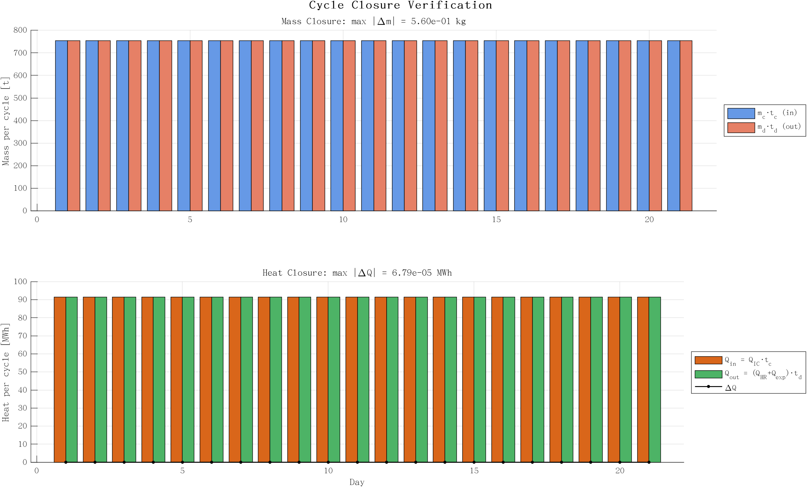

# CCES-CHP ODE 仿真图表说明

21 天动态仿真。模型：2 状态 ODE（HPT 储液质量、HTV 蓄热），定压液态储罐，
物性由 REFPROP 实时计算，设计点参数由 `cces_design_point.m` 统一给出。

调度：充电 0–7.59 h → 待机 → 放电 13.29–18.29 h → 待机，24 h 一周期。
充电时长由质量闭合反解、对外供热由热量闭合反解，故 21 个周期完全相同。

---

## fig01 — HPT 储液状态与定压说明

**左图：HPT 液态 CO₂ 存量与储气 SOC。** 充电段储液由 94 t 增至 849 t（SOC 10%→90%），
放电段回落到 94 t。满液 943 t 对应 1280 m³。

**右图：HPT 压力。** 定压液态储罐，压力由泵/背压维持在 6.80 MPa，不随储量变化。
红色虚线为 298 K 下的饱和压力 6.41 MPa，两者相差 0.39 MPa 的亚冷度，
保证节流阀前不闪蒸。这正是与论文 Eq.23（理想气体 P = mRT/V）的分歧点：
若按理想气体建模，压力会随储量大幅摆动，与"室温液态储存"矛盾。

---

## fig02 — 功率与累计能量

**上图（前 3 天放大）：** 充电段压缩机 10 MW，同时产生 12.05 MW 压缩热（Q_IC）；
放电段透平 10 MW，消耗 16.59 MW 回热（Q_HR）。两者分别对应 γ₁ = 1.205、γ₂ = 1.659。

**下图：累计能量。** 21 天累计充电 1593.2 MWh、放电 1050.0 MWh，
**电-电效率 65.9%**（= 5 h / 7.59 h，即放电时长与充电时长之比，设计点确定）。
净能量（黑虚线）在产品意义上为正：系统吸收谷电、释放尖峰电与热。

---

## fig03 — 双 SOC 与 HTV 蓄热

**左图：双状态量。** 蓝色为 Gas SOC（储液液位 10%–90%），红色为 Heat SOC（30%–90.9%），
两者在充电段同步上升、放电段同步下降。

**右图：HTV 蓄热量。** 充电段以 12.05 MW 充热（7.59 h，+91.4 MWh），
放电段以 16.59 + 1.69 = 18.28 MW 放热（5 h，−91.4 MWh），
所以每个周期精确回到 45 MWh。容量上限 150 MWh（红虚线）留有 14 MWh 裕量，
运行中从未触及，因此不存在"撞上限后削峰"的假稳态。

---

## fig04 — 逐日闭合验证（新增）

**上图：** 每个周期的进料 `m_c·t_c` 与出料 `m_d·t_d` 均为 754.4 t，柱高一致。
每日质量漂移最大 0.56 kg，相对误差 7.4×10⁻⁷（纯数值积分误差）。

**下图：** 每周期热入 `Q_IC·t_c` 与热出 `(Q_HR+Q_export)·t_d` 均为 91.4 MWh，
黑色点线为逐日残差，量级 10⁻⁵ MWh。

这张图是"储能系统物理逻辑通畅"的直接证据：质量与热量同时闭合，
系统进入严格周期稳态，而不是靠限幅制造平衡。
