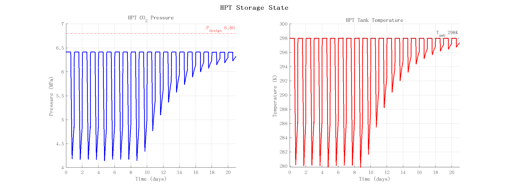
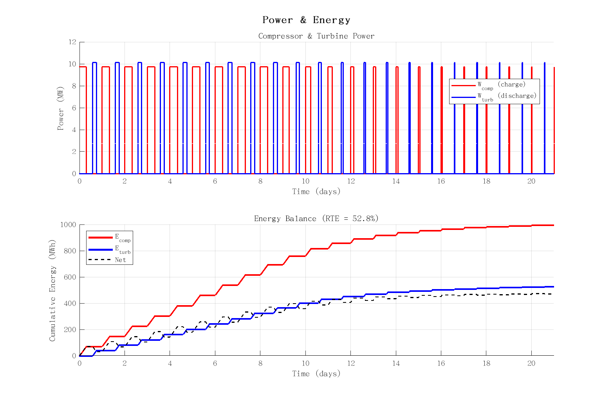
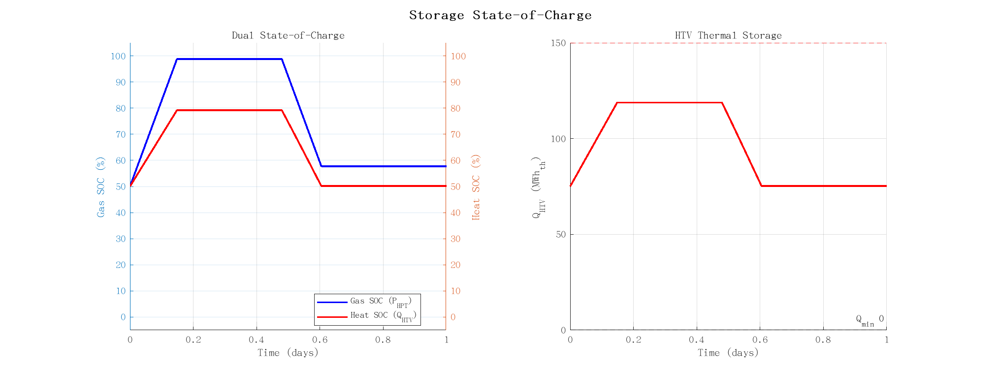

# CCES-CHP ODE 仿真图表说明

24 小时动态仿真，模型：3 状态 ODE（HPT 质量、HTV 蓄热、储罐温度），物性由 REFPROP 实时计算。

---

## fig01 — HPT 压力与温度

**左图：HPT CO2 压力。** 充电时段（0–7.5 h）CO2 被压缩进入高压储罐，压力升至上限 P_max = 6.70 MPa。
闲置时段（7.5–11.5 h）压力保持不变。放电时段（11.5–14.5 h）CO2 经透平释放，压力下降。
由于放电窗口仅 3 小时，压力未触及下限 P_min = 0.22 MPa，循环结束时罐内仍有残余压力。

**右图：HPT 储罐温度。** 充电时温度维持在环境温度（298 K）附近，因为来自液化换热器的 CO2 约 298 K。
放电时，液态 CO2 抽出，部分液体闪蒸填充气相空间，吸收潜热（~120 kJ/kg），剩余液体降温约 9 K。
放电结束后，环境传热使温度缓慢恢复至 298 K。降温在完整循环内可逆，无累积漂移。

---

## fig02 — 功率与累计能量

**上图：压缩机与透平功率。** 压缩机在充电窗口以设计功率（10 MW_e）运行，从电网取电。
透平在放电窗口以较低功率（~7 MW_e）发电，反映每 kg 热力学效率约 70%（压缩功 355 kJ/kg，透平功 251 kJ/kg，全再热温度 483 K 时）。
两者均受时间调度和压力/热储存约束控制。

**下图：累计能量平衡。** 红色曲线为压缩机累计耗电，蓝色为透平累计发电。
净能量（黑色虚线）始终为正（耗电 > 发电），系统级往返效率 RTE ≈ 55%。
每 kg 热力学 RTE 为 70.8%（全再热 483 K）；系统级 RTE 较低是因为运行约束（压力限值、热储存容量）限制连续满功率运行。

---

## fig03 — 双 SOC 与蓄热量

**左图：双状态-of-Charge。** 蓝色（左轴）为 Gas SOC，跟踪 HPT 压力占运行范围（0.10–6.80 MPa）的百分比。
红色（右轴）为 Heat SOC，跟踪高温导热油罐（HTV）蓄热量占容量（150 MWh_th）的百分比。
充电时段两者同步上升（压缩同时储存压力能和废热），放电时段两者同步下降。
Heat SOC 起始为 50%（设计假设），循环于 50%–79% 之间。

**右图：HTV 蓄热绝对值。** HTV 在充电时段接收来自压缩机中间冷却器（IC1 + IC2）的热量，
速率为 β₁ × W_comp ≈ 11.9 MW_th。放电时段为 CO2 再热消耗热量，速率为 β₂ × W_turb ≈ 16.2 MW_th。
一个完整循环内净热平衡略为正（充电 7.5 h > 放电 3 h）。
