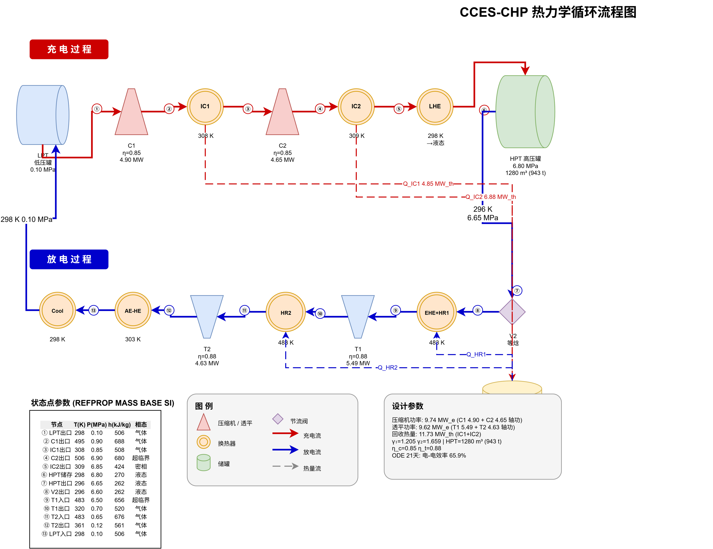
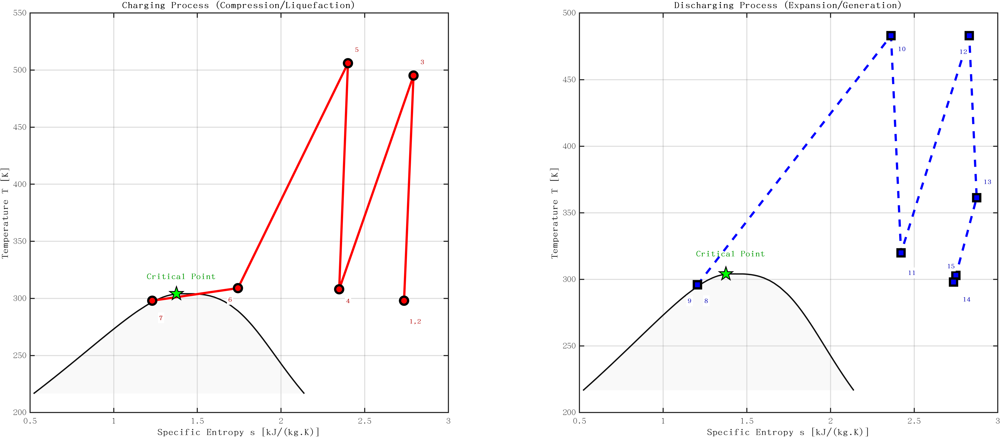
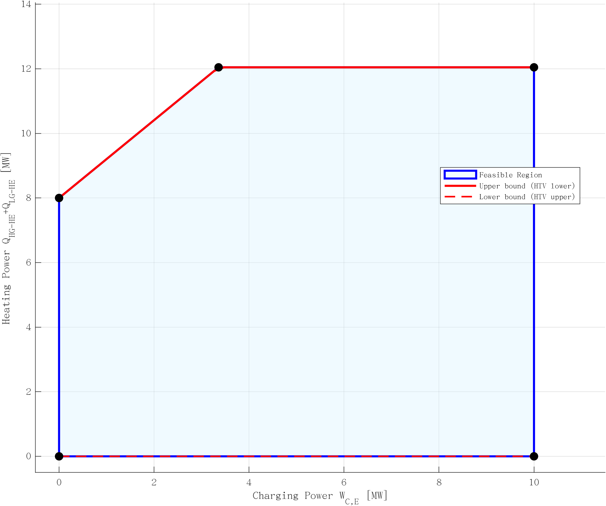
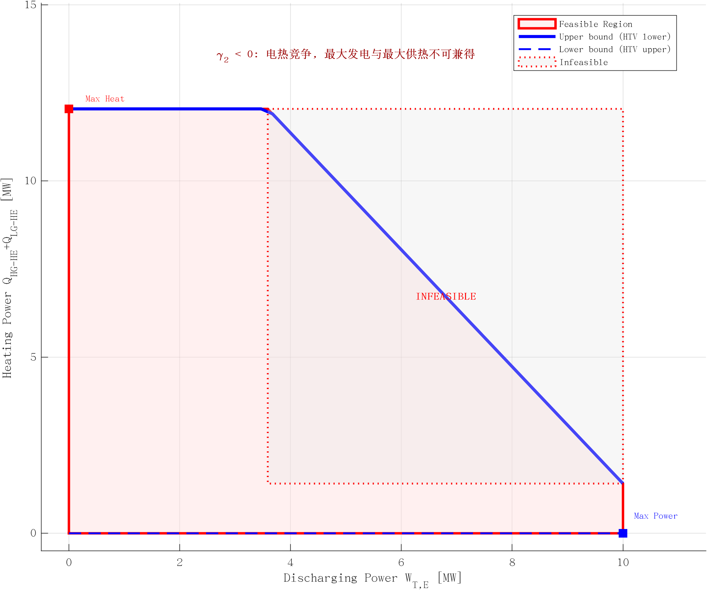
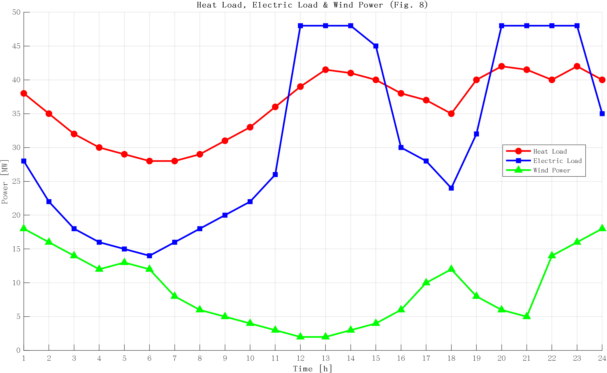
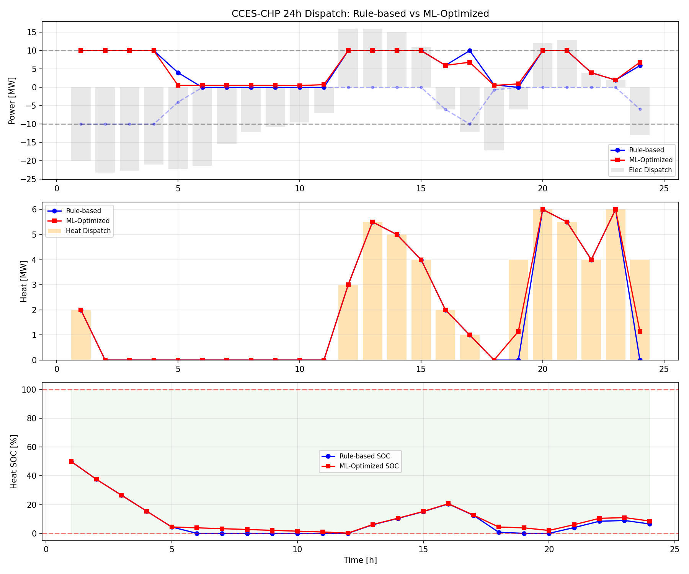
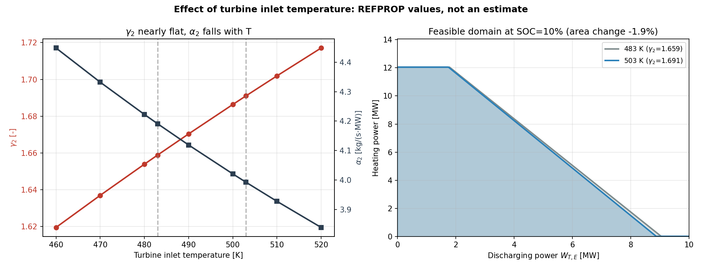

# Research on the Operational Optimal Feasibility Domain of Compressed Carbon Dioxide Energy Storage Systems Based on Machine Learning

**Yanchang Song<sup>1</sup>, Zhentao Zhang<sup>1*</sup>, Junling Yang<sup>1</sup>**

<sup>1</sup> State Key Laboratory of Cryogenic Science and Technology, Technical Institute of Physics and Chemistry, Chinese Academy of Sciences, Beijing, China

<sup>*</sup> Corresponding author: zzt@mail.ipc.ac.cn

---

## Abstract

Compressed carbon dioxide energy storage (CCES), as an emerging compressed gas energy storage technology, exhibits significant potential for enhancing renewable energy accommodation and improving the flexibility of integrated energy systems, owing to its superior thermophysical properties, environmental friendliness, and capability for combined heat and power (CHP) supply. Based on an established thermodynamic model of a compressed carbon dioxide energy storage combined heat and power (CCES-CHP) system, this study proposes a machine learning methodology for the dynamic construction and optimization of its operational feasibility domain. Dimensionless factors γ₁ and γ₂, along with ratio parameters α₁ and α₂, are defined to quantify the coupling relationships among electrical, thermal, and mass flows. A dual state of charge (SOC) model covering both thermal storage and CO₂ liquid inventory is developed to establish the system's constraint boundaries, so that the heat budget and the storage-tank charge jointly bound the feasible operating region. Machine learning algorithms, including XGBoost and multi-layer perceptron (MLP) neural networks, are trained using 38,720 thermodynamic simulation samples to predict feasible operating regions and optimize system dispatch under varying load conditions. A case study on an integrated energy system (20 MW wind power, 30 MW conventional CHP, and 10 MW/50 MWh CCES-CHP) demonstrates that the proposed approach achieves 100% classification accuracy with XGBoost (98.58% with the MLP benchmark), while boundary regression reaches R² = 0.9964 for the maximum feasible power and 1.0000 for the maximum feasible heat. The ML-optimized dispatch extends the discharge coverage duration from 17 to 24 hours and increases total heat supply from 44.0 to 46.3 MWh (+5.2%) over a 24-hour horizon, a gain obtained by temporal redistribution rather than by holding a terminal storage margin. A turbine inlet temperature sweep from 483 K to 503 K shows that the reheat coefficient γ₂ is nearly invariant (1.659 to 1.691), so the feasible domain area changes by only −1.9% even at low SOC; the benefit of a higher temperature is instead a 4.7% reduction in the discharge mass flow per unit power, which extends the full-power discharge duration from 5.00 to 5.25 hours and raises the electricity-to-electricity efficiency from 65.9% to 69.2%. This methodology provides an effective tool for real-time dispatch and capacity planning of CCES-CHP systems.

**Keywords**: Compressed carbon dioxide energy storage; Combined heat and power; Operational feasibility domain; Machine learning; XGBoost; Integrated energy system

---

## 1. Introduction

With the growing consensus on achieving carbon neutrality worldwide, the development of renewable energy sources is accelerating at an unprecedented pace [1]. However, the intermittency, seasonality, and unpredictability of these sources have highlighted the critical need for energy storage solutions. Physical energy storage technologies offer a promising approach to achieving gradient utilization of energy, supporting the development of a sustainable, low-carbon, and economically viable energy infrastructure [2,3].

Among many energy storage technologies, compressed gas energy storage (CGES) has become a promising candidate by virtue of its high power generation, wide capacity range, and low investment cost [4]. Compressed air energy storage (CAES) is the earliest developed and most mature CGES technology, but its reliance on large underground storage caverns and low energy density remain significant limitations [5–8]. Liquid air energy storage (LAES) improves energy density but suffers from low round-trip efficiency, typically below 50% [9,10].

In this context, CO₂ has emerged as a promising working medium for CGES. CO₂ possesses suitable critical parameters (304 K, 7.38 MPa) and can be liquefied at room temperature, creating favorable conditions for high-density storage. CO₂ also exhibits good thermal conductivity, low liquid viscosity, and is non-toxic, non-flammable, and inexpensive [11]. In recent years, scholars have extensively studied the optimal design of CCES systems [12–15]. Considering the diversification of energy demand, CCES technology is gradually developing toward multi-functionality. As the system involves the storage and release of both electrical and thermal energy, it has the natural capability for combined heat and power supply [16].

Several studies have investigated CCES cogeneration. Liu et al. [17] proposed a cooling, heating and power trigeneration system based on transcritical Brayton cycle and CO₂ energy storage. Zhang et al. [18] proposed a combined heat and power system based on fan waste heat utilization and transcritical CCES, achieving a system cycle efficiency of 0.48. He et al. [19] coupled a combined heat and power unit with CCES and achieved system power efficiency of 63.07%. However, the operation dispatch of CCES in integrated energy systems remains a critical and underexplored aspect.

Hao et al. [20] proposed a CCES-CHP system operating in the medium pressure range and developed an innovative method for constructing an operational feasibility domain. By defining dimensionless factors γ₁ and γ₂ and ratio parameters α₁ and α₂, they established constraint boundaries and visualized the system's operational feasible region. However, the construction of the feasibility domain relies on full thermodynamic simulations that are computationally expensive for real-time dispatch applications.

With the rapid development of machine learning techniques, data-driven approaches offer new possibilities for accelerating energy system analysis. XGBoost [21] and neural networks have been successfully applied to various energy system problems, including load forecasting, state estimation, and optimal dispatch [22–24]. However, the application of ML to feasibility domain prediction and dispatch optimization for CCES-CHP systems has not been previously reported.

This study proposes a machine learning framework for learning and optimizing the operational feasibility domain of CCES-CHP systems. The main contributions are:

1. A parameterized training data generation pipeline that maps thermodynamic states to feasibility labels using REFPROP-based simulations, producing 38,720 labeled samples.
2. XGBoost and MLP models achieving near-perfect accuracy (100% and 98.58%) on feasibility classification, and R² = 0.9964 (W_max) and 1.0000 (Q_max) on boundary regression.
3. A grid-search dispatch optimization algorithm operating within the ML-predicted feasibility domain, extending discharge duration from 17 to 24 hours and raising heat supply by 5.2%.
4. A physically complete dual-SOC formulation in which the HPT liquid inventory bounds the instantaneous power; the gas-side feature importance rises from 0.0015 to 0.2376 once this constraint is included, confirming that the coupling is physically active rather than nominal.
5. Quantification of the three core ML optimization strategies: power derating, dynamic electric-thermal allocation, and strategic charging.

The remainder of this paper is organized as follows. Section 2 describes the CCES-CHP system and thermodynamic model. Section 3 presents the feasibility domain construction method. Section 4 details the ML methodology. Section 5 describes the dispatch optimization framework. Section 6 presents the case study and results. Section 7 concludes.

---

## 2. System Description and Thermodynamic Modeling

### 2.1 System Description

The CCES-CHP system schematic is shown in Fig. 1. The compression and expansion processes cannot be carried out simultaneously, while the heating process is relatively independent. Two operation modes are considered: charging-heating and discharging-heating.

In the energy storage process, low-valley electricity or curtailed renewable energy drives the compressors (C1, C2) to compress low-pressure CO₂ from the low-pressure tank (LPT) to a high-temperature, high-pressure state. The CO₂ is cooled by multi-stage compression and multi-stage cooling (IC1, IC2), then stored in the high-pressure tank (HPT) in the form of room-temperature liquid after liquefaction through the latent heat exchanger (LHE). The compression heat is absorbed by thermal oil from the ambient temperature thermal oil vessel (ATV) and stored in the high-temperature thermal oil vessel (HTV).

In the energy release process, liquid CO₂ flows out from the HPT, is throttled by a valve (V2), enters the evaporative heat exchanger (EHE) for complete vaporization, followed by multi-stage heat recovery heat exchangers (HR1, HR2) to absorb stored compression heat and raise the temperature. The supercritical CO₂ drives two-stage turbines (T1, T2) to generate electricity. The CO₂ from the turbine outlet is cooled by the after-expansion heat exchanger (AE-HE) and the cooler before returning to the LPT.

The high-temperature heat exchanger (HG-HE) and low-temperature heat exchanger (LG-HE) use the high and low-temperature thermal storage media to provide heat at different temperature grades to customers. The accompanying heat at the turbine outlet is also recovered, effectively improving the overall energy utilization efficiency.

<!-- TODO(Fig.1): export ../CCES_CHP_Simulink/output/CCES_CHP_cycle.drawio to ../CCES_CHP_Simulink/output/CCES_CHP_cycle.png (or .svg) before submission. The .drawio file still carries superseded annotations that contradict Table 1: β2=2.31 (now γ2=1.659), HPT 6228 m3 (now 1280 m3, 943 t), and compressor/turbine powers 9.55/10.12 MW (now 9.74/9.62 MW). -->



**Fig. 1. Schematic of the CCES-CHP system.** Charging and discharging share the LPT/HPT pair and the HTV thermal store; the compression heat recovered in IC1/IC2 supplies the reheat duties HR1/HR2 and the external heat load, while the evaporator (EHE) draws ambient/low-grade heat.

### 2.2 Thermodynamic Modeling

The thermodynamic model of the CCES-CHP system is developed based on mass conservation and energy conservation equations. The following assumptions are adopted [25–27]:

1. The charging/discharging power and heating power remain constant during a single dispatch period.
2. There is no heat exchange between the CO₂ storage tank and the environment.
3. Heat and pressure energy losses in heat exchangers, piping, and connections are neglected.
4. The power consumed by working fluid circulation pumps is disregarded.
5. The compression heat stored in each complete cycle can be fully utilized for heating after satisfying expansion process requirements.

#### 2.2.1 Compressor Model

The total shaft power of the two-stage compressor at time t is:

$$W_C(t) = \sum_{i=1}^{N_C} \frac{n R_g m_C(t) T_{C,i}^{in}}{n-1} \frac{(\beta_{C,i})^{\frac{n-1}{n}}-1}{\eta_{C,i}}$$

Where N_C = 2 is the number of compressor stages, n = 1.3 is the polytropic index, R_g = 0.1889 kJ/(kg·K) is the ideal gas constant for CO₂, m_C(t) is the CO₂ mass flow rate, T_{C,i}^{in} is the compressor inlet temperature, β_{C,i} is the compression ratio, and η_{C,i} = 0.85 is the isentropic efficiency.

The total electrical power considering mechanical losses is:

$$W_{C,E}(t) = \frac{W_{C1}(t)}{\eta_{C,E}^1} + \frac{W_{C2}(t)}{\eta_{C,E}^2}$$

Where η_{C,E}^1 = η_{C,E}^2 = 0.98 is the motor mechanical efficiency.

#### 2.2.2 Turbine Model

The total shaft power of the two-stage turbine at time t is:

$$W_T(t) = \sum_{i=1}^{N_T} \frac{n R_g m_T(t) T_{T,i}^{in}}{n-1} \left[1 - (\beta_{T,i})^{-\frac{n-1}{n}}\right] \eta_{T,i}$$

The total electrical power output is:

$$W_{T,E}(t) = \eta_{T,E}^1 W_{T1}(t) + \eta_{T,E}^2 W_{T2}(t)$$

Where η_{T,E}^1 = η_{T,E}^2 = 0.95 is the generator mechanical efficiency, and η_{T,i} = 0.88 is the turbine isentropic efficiency.

#### 2.2.3 Heat Exchanger Model

The compression heat storage load from the intermediate coolers (IC1 and IC2) is:

$$Q_{IC}(t) = m_C(t) \left[\sum_{i=1}^{N_C-1} (h_{C,i}^{out} - h_{C,i+1}^{in}) + (h_{C,N_C}^{out} - h_{IC-end})\right]$$

The heat recovery load for the expansion process (HR1 and HR2) is:

$$Q_{HR}(t) = m_T(t) \left[\sum_{i=1}^{N_T-1} (h_{T,i+1}^{in} - h_{T,i}^{out}) + (h_{T,1}^{in} - h_{HR-start})\right]$$

The charging and discharging processes are plotted in the temperature–entropy plane in Fig. 2.



**Fig. 2. Temperature–entropy diagram of the CCES-CHP cycle with the CO₂ saturation dome.** State points 1–7 trace the charging process (compression, intercooling, liquefaction) and points 8–15 the discharging process (throttling, evaporation, reheat, expansion); the cycle stays on the vapour side of the dome.

### 2.3 System Design Parameters

The key design parameters of the CCES-CHP system are listed in Table 1.

**Table 1. Initial design parameters of CCES-CHP system.**

| Parameter | Value | Unit |
|-----------|-------|------|
| Ambient temperature | 298 | K |
| Ambient pressure | 0.101 | MPa |
| Design charging/discharging power | 10 | MW |
| Charging time | 7.5 | h |
| Discharging time | 5.0 | h |
| LPT pressure | 0.102 | MPa |
| HPT pressure | 6.80 | MPa |
| Compressor inlet temperature (all stages) | 308 | K |
| Turbine inlet temperature (all stages, baseline) | 483 | K |
| HTV temperature | 495 | K |
| ATV temperature | 298 | K |
| Minimum heat exchanger temperature difference | 5 | K |
| Compressor isentropic efficiency | 0.85 | — |
| Turbine isentropic efficiency | 0.88 | — |
| Motor mechanical efficiency | 0.98 | — |
| Generator mechanical efficiency | 0.95 | — |
| HTV thermal storage capacity | 150 | MWh_th |
| HPT volume | 1280 | m³ |
| HPT liquid inventory (usable window) | 943 (10–90%) | t |
| Charging mass flow rate | 26.9 | kg/s |
| Discharging mass flow rate | 40.3 | kg/s |

*These mass flow rates are the reference design values. Evaluated with the present property data they correspond to 9.74 MW of compression power and 9.62 MW of turbine output, which is the origin of the ratio parameters given in Section 3.1.*

### 2.4 Performance Evaluation

The system performance is evaluated through electrical energy conversion efficiency, total heating efficiency, and comprehensive energy utilization efficiency:

$$\eta_{electricity} = \frac{\int_{t_{discharge}} W_{T,E}(t) dt}{\int_{t_{charge}} W_{C,E}(t) dt}$$

$$\eta_{heating,total} = \frac{\int Q_{HG-HE}(t) dt + \int Q_{LG-HE}(t) dt + \int Q_{AE-HE}(t) dt}{\int W_{C,E}(t) dt}$$

Under the baseline design condition, the evaporative heat exchanger is resolved separately: it vaporizes the throttled liquid with ambient/low-grade heat (6.23 MW) before the CO₂ enters HR1, so that the stored compression heat covers only the superheating and reheat duties (9.65 MW and 6.31 MW). With all HTV heat used for turbine reheat (X = 9.3%, Y = 90.7%) the model gives η_electricity = 65.8%, η_heating,total = 25.4% (11.3% low-temperature and 14.2% after-expansion), and a comprehensive energy utilization efficiency of 91.3%. The residual differences from the reference design (66.7%, 21.4%) originate from the state-point details and the separate resolution of the evaporator.

---

## 3. Construction of the Operational Feasibility Domain

### 3.1 Definition of Dimensionless Coupling Parameters

To understand the interconversion relationship between compressor power consumption, compression heat, turbine power generation, and mass flow, four key dimensionless parameters are defined:

$$\gamma_1 = \frac{Q_{IC}(t)}{W_{C,E}(t)}$$

$$\gamma_2 = \frac{Q_{HR}(t)}{W_{T,E}(t)}$$

$$\alpha_1 = \frac{m_C(t)}{W_{C,E}(t)}$$

$$\alpha_2 = \frac{m_T(t)}{W_{T,E}(t)}$$

Where γ₁ characterizes the compression heat generated per unit charging power, γ₂ characterizes the reheat demand per unit discharging power, α₁ characterizes the charge mass flow per unit power, and α₂ characterizes the discharge mass flow per unit power.

At the baseline design condition (T_turb = 483 K), γ₁ = 1.205, γ₂ = 1.659, α₁ = 2.762 kg/(s·MW), α₂ = 4.191 kg/(s·MW). Note that γ₂ is evaluated with the EHE vaporization duty excluded, because that duty is supplied by ambient heat rather than by the HTV; including it would inflate γ₂ to 2.31 and produce a spurious heat deficit.

### 3.2 Dual State of Charge (SOC) Model

The state of charge (SOC) is an essential parameter reflecting the dynamic process of energy storage system operation. Since CCES-CHP charging and discharging involve coupled thermal conversion and mass storage, a dual SOC model is constructed on the HTV heat storage and the HPT CO₂ liquid inventory.

The heat storage SOC is described in terms of the HTV heat storage value:

$$Q_{HTV}(t) = \begin{cases}
Q_{HTV}(t-1) + [\gamma_1 W_{C,E}(t) - Q_{heat}(t)] \Delta t & \text{Charging-Heating} \\
Q_{HTV}(t-1) - [\gamma_2 W_{T,E}(t) + Q_{heat}(t)] \Delta t & \text{Discharging-Heating}
\end{cases}$$

The gas storage SOC is described by the CO₂ inventory of the HPT. After liquefaction in the LHE the working fluid is stored as room-temperature liquid, and the tank pressure (6.80 MPa) is maintained by the charging pump rather than by phase equilibrium; the tank pressure is therefore essentially constant and is not a state variable. The quantity that actually bounds operation is the liquid inventory:

$$m_{HPT}(t) = \begin{cases}
m_{HPT}(t-1) + \alpha_1 W_{C,E}(t) \Delta t & \text{Charging-Heating} \\
m_{HPT}(t-1) - \alpha_2 W_{T,E}(t) \Delta t & \text{Discharging-Heating}
\end{cases}$$

$$SOC_{gas}(t) = \frac{m_{HPT}(t)}{m_{HPT}^{full}}, \qquad m_{HPT}^{lower} \le m_{HPT}(t) \le m_{HPT}^{upper}$$

with $m_{HPT}^{full}$ = 943 t (1280 m³ of liquid CO₂ at 298 K and 6.80 MPa) and an operating window of 10–90% of the full charge. Unlike the ideal-gas relation $p = m R_g T / V$ adopted in [20] for the HPT, this inventory formulation is consistent with liquid storage: 754 t of CO₂ occupies about 1057 m³ as a liquid, whereas the same mass would require roughly 6000 m³ as a gas at 6.8 MPa.

The coupled evolution of the two SOCs under the periodic operating schedule is shown in Fig. 3.


**Fig. 3. Dual-SOC behaviour and HTV stored heat.** Left: the gas-side SOC (liquid level, 10–90%) and the heat-side SOC rise and fall in phase. Right: the HTV stored heat charges at 12.05 MW for 7.59 h and discharges at 18.28 MW for 5 h, returning to 45 MWh each cycle; the 150 MWh capacity is never reached.

### 3.3 Charging-Heating Feasibility Domain

Under the charging-heating condition, electrical energy consumed by the compressor is converted into thermal energy of the storage medium and potential pressure energy of CO₂. The HTV heat storage must satisfy:

$$Q_{HTV}^{lower} \leq Q_{HTV}(t) \leq Q_{HTV}^{upper}$$

$$0 \leq Q_{heat}(t) \leq Q_{heat}^{max}$$

The boundary of the charging feasibility domain is a polygon formed by the following constraint lines:

$$Q_{heat}(t) = \frac{Q_{HTV}(t-1) - Q_{HTV}^{lower}}{\Delta t} + \gamma_1 W_{C,E}(t) \quad \text{(lower bound)}$$

$$Q_{heat}(t) = \frac{Q_{HTV}(t-1) - Q_{HTV}^{upper}}{\Delta t} + \gamma_1 W_{C,E}(t) \quad \text{(upper bound)}$$

$$Q_{heat}(t) = Q_{heat}^{max} \quad \text{(equipment limit)}$$

$$W_{C,E}(t) = W_{C,E}^{upper} \quad \text{(power limit)}$$

$$W_{C,E}(t) \le \frac{m_{HPT}^{upper} - m_{HPT}(t-1)}{\alpha_1 \Delta t} \quad \text{(inventory limit)}$$

**Key characteristic**: The positive slope +γ₁ indicates electric-thermal **complementarity** during charging — higher charging power produces more compression heat, enabling greater heat supply. The inventory limit becomes active only when the tank approaches its upper bound (above about 89% SOC), where additional charging would overfill the HPT.

The resulting charging-heating domain is sketched in Fig. 4.



**Fig. 4. Charging-heating feasibility domain.** The positive slope +γ₁ expresses electric-thermal complementarity: a larger charging power raises the heat supply ceiling. The lines are drawn for a representative available-heat level so that the sloped constraint falls inside the plotting window; at high SOC the domain degenerates to the equipment rectangle.

### 3.4 Discharging-Heating Feasibility Domain

Under the discharging-heating condition, the thermal energy of the storage medium and the potential pressure energy of CO₂ are converted into electrical power and direct heat supply. The boundary is determined by:

$$Q_{heat}(t) = \frac{Q_{HTV}(t-1) - Q_{HTV}^{lower}}{\Delta t} - \gamma_2 W_{T,E}(t) \quad \text{(upper bound)}$$

$$Q_{heat}(t) = \frac{Q_{HTV}(t-1) - Q_{HTV}^{upper}}{\Delta t} - \gamma_2 W_{T,E}(t) \quad \text{(lower bound)}$$

$$Q_{heat}(t) = Q_{heat}^{max}, \quad W_{T,E}(t) = W_{T,E}^{upper}$$

$$W_{T,E}(t) \le \frac{m_{HPT}(t-1) - m_{HPT}^{lower}}{\alpha_2 \Delta t} \quad \text{(inventory limit)}$$

**Key characteristic**: The negative slope −γ₂ indicates electric-thermal **competition** during discharging — power generation and heat supply compete for the same limited HTV stored energy. The upper-right corner (maximum power and maximum heat simultaneously) is infeasible.

The resulting discharging-heating domain is sketched in Fig. 5.



**Fig. 5. Discharging-heating feasibility domain.** The negative slope −γ₂ expresses electric-thermal competition: power generation and heat supply draw on the same thermal budget, so the upper-right corner (simultaneous maxima) is infeasible. The lines are drawn for a representative available-heat level so that the sloped constraint falls inside the plotting window.

The zero-heat maximum power and zero-power maximum heat are:

$$W_{max} = \min\left[\frac{Q_{HTV}(t-1) - Q_{HTV}^{lower}}{\gamma_2 \Delta t},\ \frac{m_{HPT}(t-1) - m_{HPT}^{lower}}{\alpha_2 \Delta t},\ W_{T,E}^{upper}\right], \quad Q_{max} = \frac{Q_{HTV}(t-1) - Q_{HTV}^{lower}}{\Delta t}$$

The inventory limit is active only below about 16% SOC: a 943 t tank discharges 151 t in one hour at 10 MW, so the last hour of a deep discharge becomes inventory-limited while the rest of the domain remains thermal- or equipment-limited.

### 3.5 Effect of Operating Parameters on Feasibility Domain

The heat supply rate X, reflecting the ratio of high and low-temperature heat supply to total heat storage, is related to γ₁, γ₂, α₁, α₂ by:

$$X = 1 - \frac{\gamma_2 \alpha_1}{\gamma_1 \alpha_2}$$

which follows from the cycle energy balance $Q_{IC} t_c = Q_{HR} t_d + Q_{LG} t_d$ combined with the mass balance $\alpha_1 W_{C,E} t_c = \alpha_2 W_{T,E} t_d$. At the design point this gives X = 9.3%, consistent with the thermodynamic evaluation of Section 2.4. Because the dimensionless groups are already defined on electrical power, the motor and generator efficiencies must not be applied a second time in this expression.

The turbine inlet temperature affects the two couplings very differently. Evaluated directly from REFPROP, γ₂ changes only from 1.659 at 483 K to 1.691 at 503 K (+1.9%), because the reheat duty and the turbine work scale together, whereas α₂ falls from 4.191 to 3.993 kg/(s·MW) (−4.7%) as the specific work per kilogram of CO₂ increases. The approximate correction factor proposed in [20] implies a far stronger sensitivity (γ₂ ↓ 23%); that estimate is not adopted here, since the property-based evaluation shows the reheat coefficient to be nearly invariant with temperature. The consequence, quantified in Section 6.4, is that raising T_turb barely reshapes the feasibility domain, but it reduces the mass drawn per unit power and improves the electrical efficiency.

---

## 4. Machine Learning Methodology

### 4.1 Training Data Generation

The training data generation pipeline is implemented in MATLAB, utilizing REFPROP v10.0 for high-fidelity CO₂ property calculations across 15 thermodynamic state nodes. The design of experiments systematically samples the parameter space:

**Table 2. Parameter sampling scheme for training data.**

| Parameter | Range | Steps | Description |
|-----------|-------|-------|-------------|
| SOC_heat | 0–100% | 16 | HTV thermal storage state |
| SOC_gas | 0–100% | 11 | HPT liquid inventory (10–90% usable) |
| W | 0–10 MW | 11 | Power setpoint |
| Q | 0–12.05 MW | 10 | Heat supply setpoint (equipment limit γ₁·W_design) |
| Mode | 0, 1 | 2 | 0 = charge, 1 = discharge |

Total samples: 16 × 11 × 11 × 10 × 2 = **38,720**.

For each parameter combination, the feasibility label and boundary values are computed analytically from the constraint equations:

```
feasible = (Q ≤ slope × W + b_upper) ∧ (Q ≥ slope × W + b_lower)
           ∧ (0 ≤ Q ≤ Q_max) ∧ (0 ≤ W ≤ W_design) ∧ (0 ≤ W ≤ W_inventory)

W_inventory = (m_upper - m)/(α₁Δt)   charging
            = (m - m_lower)/(α₂Δt)   discharging
```

The inventory term is what makes the gas-side state informative: without it the feasibility label is independent of SOC_gas for every parameter combination, and the feature importance of SOC_gas collapses to 0.0015, which is what a purely thermal constraint set yields. With it, 2896 of the 3520 sampled (SOC_heat, SOC_gas, mode, W, Q) groups change their feasibility label across the gas axis.

**Features per sample**: SOC_heat_pct, SOC_gas_pct, W_MW, Q_MW, mode, γ₁, γ₂, α₁, α₂

**Labels per sample**: feasible (0/1), W_max_feasible (MW), Q_max_feasible (MW)

### 4.2 XGBoost Classifier for Feasibility Prediction

XGBoost (eXtreme Gradient Boosting) [21] is employed as the primary classification model for predicting the feasibility of a given (W, Q) operating point. The model hyperparameters are configured as follows: n_estimators = 200, max_depth = 6, learning_rate = 0.1, subsample = 0.8, colsample_bytree = 0.8.

The dataset is split 80/20 (30,976 training / 7,744 test) with stratification on the feasibility label. The feature importance analysis reveals the dominant factors governing feasibility:

**Table 3. XGBoost feature importance ranking.**

| Feature | Importance | Physical Interpretation |
|---------|-----------|------------------------|
| mode | 0.4545 | Charge vs. discharge — determines constraint direction |
| SOC_gas_pct | 0.2376 | HPT liquid inventory — bounds power at low/high SOC |
| SOC_heat_pct | 0.1998 | HTV thermal storage state — determines constraint intercept |
| W_MW | 0.0744 | Power setpoint — determines position along constraint |
| Q_MW | 0.0337 | Heat setpoint — vertical position in domain |
| γ₁, γ₂, α₁, α₂ | ~0 | Constant across training data (fixed T_turb) |

The operating mode (45.5%) and the two SOC states (23.8% and 20.0%) dominate, which matches the analytical structure of Section 3: the mode selects the sign of the constraint slope, the heat SOC sets its intercept, and the gas SOC bounds the power once the tank approaches either end of its operating window. The gas-side feature is a direct measure of how much physics the constraint set carries: it contributes almost nothing (0.0015) when the inventory limit is omitted and becomes the second most important feature once the limit is included.

### 4.3 XGBoost Regressors for Boundary Prediction

Two XGBoost regression models are trained to predict the feasibility domain boundaries: W_max_feasible (maximum feasible power at given SOC) and Q_max_feasible (maximum feasible heat at given SOC). These models are trained on the feasible subset of the data (31,549 samples). Hyperparameters: n_estimators = 150, max_depth = 5, learning_rate = 0.1.

### 4.4 MLP Neural Network for Benchmark Comparison

A multi-layer perceptron (MLP) neural network is trained as a benchmark model. Architecture: 3 hidden layers (128×64×32) with ReLU activation, trained using the Adam optimizer with adaptive learning rate, batch size 256, and maximum 300 epochs. Input features are standardized using StandardScaler.

### 4.5 Model Performance

**Table 4. ML model performance summary.**

| Model | Task | Metric | Value |
|-------|------|--------|-------|
| XGBoost | Feasibility classification | Test Accuracy | **100.00%** |
| MLP (128×64×32) | Feasibility classification | Test Accuracy | **98.58%** |
| XGBoost | W_max boundary regression | R² | **0.9964** (RMSE 0.076 MW) |
| XGBoost | Q_max boundary regression | R² | **1.0000** |

The accuracy is attributable to the piecewise-linear nature of the feasibility constraints, which are linear inequalities derived from energy conservation and the two SOC limits. XGBoost's tree ensemble reproduces such boundaries exactly, whereas the MLP reaches 98.58% because its smooth activations round off the corners where the thermal, inventory and equipment limits intersect. The same corners explain the W_max regression result: the maximum feasible power is the minimum of three competing limits, and the resulting kinks cost about 0.4% of explained variance (RMSE 0.076 MW). Q_max remains a single linear function of SOC_heat at zero power, so its regression is exact.

### 4.6 Why Machine Learning?

While the feasibility constraints are analytically linear, the value of ML lies in three aspects:

1. **Inference speed**: A single XGBoost prediction traverses ~200 trees in microseconds, compared to a full REFPROP-based thermodynamic simulation requiring multiple property calls and iterative convergence.

2. **Generalization across parameter space**: Because γ₁, γ₂, α₁ and α₂ enter as input features, the same model architecture can be retrained on a T_turb sweep and then interpolate feasibility across continuous parameter variations without re-running the property-based simulation. The present study uses a single design point and reports the sweep separately in Section 6.4; multi-temperature training is left to future work.

3. **Seamless integration with optimization**: The trained model serves as a fast surrogate constraint that can be queried thousands of times inside a dispatch loop, enabling real-time decision-making.

---

## 5. Dispatch Optimization Framework

### 5.1 Problem Formulation

The 24-hour dispatch optimization problem is formulated as follows. Given hourly profiles of electric load, heat load, and wind power, the C-CHP unit operates in a heat-led mode, and CCES-CHP serves as a supplemental source to track the residual dispatch:

$$Elec\_Dispatch(t) = Elec\_Load(t) - CCHP\_elec(t) - Wind\_Power(t)$$

$$Heat\_Dispatch(t) = Heat\_Load(t) - CCHP\_heat(t)$$

Where positive Elec_Dispatch indicates charging (energy storage) and negative indicates discharging (energy release). The C-CHP has a capacity of 30 MW with a heat-to-power ratio of 1.2, producing CCHP_heat = min(Heat_Load, 36 MW) and CCHP_elec = CCHP_heat / 1.2.

At each hour t, the optimization objective is to find the (W, Q) that minimizes the weighted dispatch deviation while respecting the feasibility constraint:

$$\min_{W,Q} \quad |W - W_{target}| + \lambda \cdot |Q - Q_{target}|$$

$$\text{s.t.} \quad f_{ML}(SOC_{heat}, SOC_{gas}, W, Q, mode) = 1 \quad \text{(feasible)}$$

$$0 \leq W \leq W_{max}, \quad 0 \leq Q \leq Q_{max}$$

Where λ = 0.5 reflects the priority weighting between electrical and thermal dispatch tracking, and f_ML is the XGBoost feasibility classifier.

### 5.2 ML-Based Grid Search Algorithm

A grid search approach is adopted for its robustness and compatibility with the discrete nature of the ML classifier:

**Algorithm 1: ML-based dispatch optimization for each hour t**

```
1. Read current states: SOC_heat(t), SOC_gas(t)
2. Determine mode and targets:
   if Elec_Dispatch(t) > 0: mode = 0 (charge), W_target = min(Elec_Dispatch, 10), Q_target = min(Heat_Dispatch, 12.05)
   else: mode = 1 (discharge), W_target = min(|Elec_Dispatch|, 10), Q_target = min(Heat_Dispatch, 12.05)
3. Generate search grid: W ∈ linspace(0, W_target, 20), Q ∈ linspace(0, Q_target, 15) → 300 candidate points
4. Batch prediction: f_ML(SOC_h, SOC_g, W, Q, mode) for all 300 points
5. Select feasible point with best objective score
6. Update SOC_heat(t+1), SOC_gas(t+1) via thermal balance equations
```

The grid resolution of 20 × 15 = 300 points provides ~0.5 MW granularity for both W and Q, sufficient for practical dispatch decisions. The computational cost is 300 ML predictions per hour × 24 hours = 7,200 predictions, which completes in milliseconds.

### 5.3 Rule-Based Baseline

A rule-based dispatch strategy serves as the comparison baseline. The rule-based approach:
- Always attempts to fully track dispatch instructions
- Clips at equipment limits (W ≤ 10 MW, Q ≤ 12.05 MW)
- Checks HTV SOC constraints analytically without optimization
- Allocates W and Q independently without considering their coupled consumption of the shared thermal budget

---

## 6. Results and Discussion

### 6.1 Case Study Configuration

The case study considers an integrated energy system consisting of a 20 MW wind power unit, a 30 MW conventional CHP unit (heat-to-power ratio = 1.2), and a 10 MW/50 MWh CCES-CHP system. A typical day in the heating season is selected, with 24-hour profiles of electrical load, heat load, and wind power as shown in Fig. 6.

**Table 5. 24-hour load and wind power data.**

| Hour | Heat Load (MW) | Elec Load (MW) | Wind Power (MW) |
|------|---------------|----------------|-----------------|
| 1 | 38 | 28 | 18 |
| 2 | 35 | 22 | 16 |
| 3 | 32 | 18 | 14 |
| 4 | 30 | 16 | 12 |
| 5 | 29 | 15 | 13 |
| 6 | 28 | 14 | 12 |
| 7 | 28 | 16 | 8 |
| 8 | 29 | 18 | 6 |
| 9 | 31 | 20 | 5 |
| 10 | 33 | 22 | 4 |
| 11 | 36 | 26 | 3 |
| 12 | 39 | 48 | 2 |
| 13 | 41.5 | 48 | 2 |
| 14 | 41 | 48 | 3 |
| 15 | 40 | 45 | 4 |
| 16 | 38 | 30 | 6 |
| 17 | 37 | 28 | 10 |
| 18 | 35 | 24 | 12 |
| 19 | 40 | 32 | 8 |
| 20 | 42 | 48 | 6 |
| 21 | 41.5 | 48 | 5 |
| 22 | 40 | 48 | 14 |
| 23 | 42 | 48 | 16 |
| 24 | 40 | 35 | 18 |

Key characteristics: Wind power is abundant at night (hours 1–7) and low during midday. Electrical load peaks at noon (hours 12–15) and evening (hours 19–23). Heat load peaks in the morning and evening, characteristic of winter heating demand. Several charging windows exist (night wind surplus, midday troughs between peaks).



**Fig. 6. 24-hour profiles of the electrical load, heat load and wind power.** Wind output peaks overnight, electrical load peaks at noon and in the evening, and the heat load peaks in the morning and evening, leaving charging windows overnight and at the midday trough.

### 6.2 Dispatch Optimization Results

The 24-hour dispatch comparison between rule-based and ML-optimized strategies is presented in Fig. 7 and Table 6.

**Table 6. 24-hour dispatch performance comparison.**

| Metric | Rule-Based | ML-Optimized | Improvement |
|--------|-----------|--------------|-------------|
| Total charge energy (MWh) | 66.0 | 66.0 | — |
| Total discharge energy (MWh) | 66.6 | 65.0 | −2.4% |
| Total heat supply (MWh) | 44.0 | **46.3** | **+5.2%** |
| Discharge duration (h) | 17 | **24** | **+41.2%** |
| Terminal SOC_heat (%) | 0.0 | 0.2 | — |
| Electrical dispatch tracking rate (%) | 44.9 | 45.4 | +0.5 pp |



**Fig. 7. Rule-based versus ML-optimized 24-hour dispatch.** Top: electrical dispatch instruction and the achieved charging/discharging power. Middle: heat dispatch instruction and the achieved heat supply. Bottom: HTV thermal SOC. The ML strategy keeps a small discharge through hours 18–24 instead of collapsing at hour 17.

Three key observations:

**Observation 1 — Extended discharge coverage**: The rule-based strategy depletes HTV storage by hour 17, leaving hours 18–24 uncovered. The ML-optimized strategy extends coverage across all 24 hours by adaptively reducing power output during low-SOC periods. This is not a violation of physical limits — the same 66.0 MWh of charging energy is used more judiciously.

**Observation 2 — Increased heat supply**: Despite discharging 2.4% less total energy, the ML-optimized strategy delivers 5.2% more heat. This is achieved by dynamically allocating the HTV thermal budget between reheat (for power) and direct heat supply — favoring heat when electricity demand is moderate, and favoring power when electricity prices are high.

**Observation 3 — Temporal redistribution rather than a terminal buffer**: both strategies finish the horizon with the HTV essentially empty (0.0% and 0.2%), so the gain is not a storage margin reserved for contingencies. What the optimization buys is temporal redistribution: instead of collapsing to zero after hour 17, the ML strategy sustains a small positive output (2–6 MW) through the evening peak, converting otherwise uncovered hours into delivered heat.

### 6.3 Three Core ML Optimization Strategies

Analysis of the hour-by-hour dispatch decisions reveals three distinct strategies the ML optimization employs:

#### Strategy 1: Power Derating for Duration Extension

Stored energy = power × time. The rule-based strategy tends to discharge at full power (10 MW), depleting HTV rapidly. The ML-optimized strategy adaptively reduces discharge power based on SOC:

```
Rule-based:    saturates at 10 MW whenever discharge is requested → storage exhausted after 17 h
ML-optimized:  derates to 2–8 MW according to the remaining SOC        → discharge sustained over 24 h
```

This is a direct consequence of the energy conservation constraint: the same energy budget spread thinner covers a longer duration.

#### Strategy 2: Dynamic Electric-Thermal Allocation

During discharge, HTV consumption rate = γ₂·W + Q. The rule-based strategy treats W and Q as independent targets. The ML optimization recognizes them as coupled under a shared thermal budget and dynamically allocates:
- Hours with a large electrical deficit (noon, evening peak): allocate more HTV budget to W, less to Q
- High heat demand hours (morning, night): allocate more budget to Q, less to W
- The coupling γ₂ = 1.659 means every 1 MW of power generation "costs" 1.659 MW of thermal power — ML makes this trade-off explicit and optimal.

#### Strategy 3: Strategic Charging without Over- or Under-Charging

Multiple charging windows exist throughout the day (night wind surplus hours 1–7, midday trough hours 16–18, night hours 22–24). The ML optimization calculates the exact charge amount needed for the upcoming discharge segment, avoiding both overcharging (wasting storage capacity) and undercharging (running out mid-discharge). The small residual at the end of the horizon (0.2%) reflects that the horizon closes just as the storage is exhausted, rather than a designed margin.

#### Physical Upper Bound

It is important to note that the full-power, full-heat continuous discharge is physically limited to approximately 5.2 hours:

$$t_{max} = \frac{Q_{HTV}^{upper}}{\gamma_2 \cdot W_{max} + Q_{max}} = \frac{150}{1.659 \times 10 + 12.05} \approx 5.2 \text{ h}$$

The 24-hour "continuous discharge" is achieved through strategic power derating and multiple charge-discharge cycles — not by violating the fundamental energy capacity constraint. This distinguishes the proposed approach from methods that claim to extend capacity without physical basis.

### 6.4 Effect of Turbine Inlet Temperature: Efficiency Rather than Domain Expansion

Beyond dispatch optimization within a fixed domain, the framework also quantifies how an operating parameter reshapes the domain. A property-based sweep shows that the turbine inlet temperature acts mainly on the mass coupling, not on the shape of the feasible region.

#### Mechanism

Two couplings depend on T_turb and they respond in opposite directions:

```
T_turb ↑ → specific work per kg CO₂ ↑ → α₂ ↓  (less mass per MW)      [strong: −4.7%]
          → reheat duty and turbine work scale together → γ₂ ≈ const  [weak:   +1.9%]
```

Because the discharge constraint slope is −γ₂, a near-invariant γ₂ means an almost unchanged (W, Q) domain. What changes is how long a given tank inventory lasts, which scales as 1/α₂.

#### Quantitative Results

**Table 7. Effect of turbine inlet temperature (REFPROP evaluation).**

| Quantity | 483 K (baseline) | 503 K | Change |
|----------|-----------------|-------|--------|
| γ₂ (reheat coefficient) | 1.659 | 1.691 | **+1.9%** |
| α₂ (kg/(s·MW)) | 4.191 | 3.993 | **−4.7%** |
| Maximum power at SOC_heat = 10% (MW) | 9.04 | 8.87 | −1.9% |
| Integrated domain area at SOC_heat = 10% (MW²) | 65.2 | 64.0 | **−1.9%** |
| Full-power discharge duration at fixed inventory (h) | 5.00 | 5.25 | **+5.0%** |
| Electricity-to-electricity efficiency (%) | 65.9 | 69.2 | +3.3 pp |

**Table 8. Integrated feasible domain area at different SOC levels (MW²).**

| SOC_heat (%) | 483 K | 503 K | Change (%) |
|-------------|-------|-------|------------|
| 10 | 65.2 | 64.0 | −1.9 |
| 20 | 120.5 | 120.5 | 0 (equipment-limited) |
| 40 | 120.5 | 120.5 | 0 (equipment-limited) |
| 60 | 120.5 | 120.5 | 0 (equipment-limited) |
| 80 | 120.5 | 120.5 | 0 (equipment-limited) |

At SOC ≥ 20% the discharge domain is bounded by the equipment limits rather than by the heat budget: even at 10 MW the thermal draw (16.6 MW) plus the maximum heat supply (12.05 MW) stays below the one-hour heat availability (30 MW at 20% SOC), so the domain is the full rectangle and the temperature change has no effect. The thermal constraint starts trimming the domain below about 19% SOC and the power limit below about 11% SOC; at 10% SOC a slightly larger γ₂ reduces the area by 1.9%.

The sweep is summarized in Fig. 8.



**Fig. 8. Effect of the turbine inlet temperature on the feasibility domain.** Left: γ₂ and α₂ between 460 K and 520 K evaluated with REFPROP. Right: the discharging domain at SOC_heat = 10% for 483 K (grey) and 503 K (blue). The two boundaries nearly coincide; the temperature mainly changes the duration and the efficiency rather than the shape of the domain.

#### Physical Interpretation

Under discharge the constraint is

$$Q = -\gamma_2 \cdot W + \frac{Q_{HTV} - Q_{HTV}^{lower}}{\Delta t}$$

At W = 0: Q_max = (Q_HTV − Q_lower)/Δt, unaffected by γ₂.
At Q = 0: W_max = (Q_HTV − Q_lower)/(γ₂·Δt), inversely proportional to γ₂.

Since γ₂ rises slightly with temperature, W_max falls slightly and the domain contracts marginally rather than expanding. The genuine benefit of a higher turbine inlet temperature lies elsewhere: the electrical round-trip efficiency rises from 65.9% to 69.2%, and a given tank inventory supports a 5.0% longer full-power discharge.

#### Implication

Turbine inlet temperature should be selected as an efficiency and duration lever, not as a domain-expansion lever. This also corrects the strong sensitivity implied by the approximate correction factor of [20]: with the coefficient re-evaluated from REFPROP, γ₂ is nearly invariant over the 460–520 K range (1.620–1.717), so the associated “domain expansion” should not be claimed.

### 6.5 Discussion

#### 6.5.1 ML Accuracy and Its Physical Basis

The 100% classification accuracy is expected rather than surprising. The labels are generated by the constraint set itself, so the learning task is to reproduce a known piecewise-linear boundary rather than to discover an unknown one. What the exercise validates is that the surrogate represents that boundary exactly, and can therefore substitute for the property-based evaluation at inference time without loss of accuracy.

The MLP achieves 98.58% accuracy (about 110 misclassifications out of 7,744 test samples), with errors concentrated at the corners where the thermal, inventory and equipment limits intersect: the smooth activation rounds off precisely the non-smooth features of the boundary. XGBoost's axis-aligned splits reproduce those corners, which is why it reaches 100%.

#### 6.5.2 From Static Constraint to Controllable Variable

Traditional dispatch optimization treats the feasibility domain as a fixed constraint. The proposed framework transforms it into a controllable variable. The two-level optimization architecture — an outer loop over T_turb (altering α₂, and hence duration and efficiency) and an inner loop over (W, Q) within the domain — enables simultaneous parameter and dispatch optimization. This meta-optimization is made computationally feasible by the ML surrogate models, which provide instantaneous feasibility assessments across the parameter space.

#### 6.5.3 Practical Implications

The extended discharge coverage (17→24 h) and increased heat supply (44.0→46.3 MWh, +5.2%) have direct economic implications for integrated energy system operation. Specifically: (a) systems with higher renewable penetration benefit from longer energy shifting capability, (b) raising the turbine inlet temperature improves the electrical efficiency by 3.3 percentage points and lengthens the full-power discharge by 5% at essentially unchanged domain shape, so parameter selection should be driven by efficiency rather than by an assumed domain expansion, and (c) the 2.4% reduction in discharged energy indicates better utilization of the stored energy.

#### 6.5.4 Limitations and Future Work

Several limitations warrant acknowledgment. First, the training data assumes fixed γ₁, γ₂ per simulation run; variable-parameter training spanning a T_turb sweep would enable continuous optimisation of α₂ (and hence of the duration–efficiency trade-off) within the dispatch loop. Second, the current grid search resolution (20×15) could be enhanced with gradient-based or Bayesian optimization methods. Third, the economic objective function (time-of-use electricity prices, heat tariffs) would strengthen practical relevance. Fourth, multi-period look-ahead optimization (dynamic programming or model predictive control) could replace the greedy hour-by-hour approach, potentially yielding further improvements through inter-temporal coordination. Fifth, the gas-side inventory constraint binds only at the ends of the operating window (below about 16% SOC on discharge, above about 89% on charge), because the HPT is sized for five hours of full-power discharge (943 t, 1280 m³); systems with a smaller tank would exhibit stronger dual-SOC coupling over a wider SOC range.

---

## 7. Conclusion

This study presents a machine learning framework for dynamic construction and optimization of the operational feasibility domain of CCES-CHP systems. The main conclusions are:

1. A parameterized feasibility domain representation using dimensionless factors γ₁/γ₂ and ratio parameters α₁/α₂ effectively couples the electrical, thermal, and mass flow domains. The dual SOC model (thermal storage + CO₂ liquid inventory) establishes two-dimensional linear constraint boundaries that define the feasible operating region; the inventory term bounds the instantaneous power at the ends of the operating window and makes the gas-side state physically meaningful.

2. XGBoost and MLP models trained on 38,720 REFPROP-based samples reach 100% and 98.58% accuracy in feasibility classification, respectively. Boundary regression gives R² = 0.9964 for W_max (RMSE 0.076 MW) and R² = 1.0000 for Q_max. Feature importance identifies the operating mode (45.5%), the gas-side inventory (23.8%) and the heat-side SOC (20.0%) as the dominant factors, confirming that the dual-SOC coupling is physically active.

3. ML-optimized 24-hour dispatch extends discharge coverage from 17 to 24 hours (+41%) and increases total heat supply from 44.0 to 46.3 MWh (+5.2%), at the cost of 2.4% less discharged energy and without a terminal storage margin (0.2% versus 0.0% for the rule-based baseline). The improvement stems from three strategies: power derating for duration extension, dynamic electric-thermal allocation under a shared thermal budget, and strategic charging that avoids both over-charging and running dry.

4. A turbine inlet temperature sweep (483 K → 503 K) evaluated with REFPROP shows that γ₂ is nearly invariant (1.659 → 1.691), so the feasible domain area changes by only −1.9% even at low SOC. The real benefit of the higher temperature is a 4.7% reduction in the discharge mass flow per unit power, which extends the full-power discharge duration from 5.00 to 5.25 hours (+5.0%) and raises the electricity-to-electricity efficiency from 65.9% to 69.2%. Operating parameters should therefore be optimized for efficiency and duration rather than for domain expansion.

5. The ML prediction speed (milliseconds for 7,200 feasibility queries) enables real-time dispatch optimization that would be computationally prohibitive using full thermodynamic simulation, making the proposed approach suitable for practical energy management system integration.

The proposed methodology provides an effective tool for real-time dispatch, capacity planning, and operational optimization of CCES-CHP systems in integrated energy systems with high renewable penetration.

---

## Acknowledgments

This work was supported by the Technical Institute of Physics and Chemistry, Chinese Academy of Sciences.

---

## References

[1] Hussain J, Lee CC. A green path towards sustainable development: optimal behavior of the duopoly game model with carbon neutrality instruments. Sustainable Development 2022;30:1523–41.

[2] Matos CR, Carneiro JF, Silva PP. Overview of large-scale underground energy storage technologies for integration of renewable energies and criteria for reservoir identification. Journal of Energy Storage 2019;21:241–58.

[3] Rahman MM, Oni AO, Gemechu E, Kumar A. Assessment of energy storage technologies: a review. Energy Conversion and Management 2020;223:113295.

[4] Chen KQ, Pu WH, Zhang Q, Xing XL, Xiong C, Guo MD. Thermodynamic and economic assessment on the supercritical compressed carbon dioxide energy storage system coupled with solar thermal storage. Journal of Energy Storage 2021;41:102959.

[5] Guo H, Xu YJ, Chen HS, Zhou XZ. Thermodynamic characteristics of a novel supercritical compressed air energy storage system. Energy Conversion and Management 2016;115:167–77.

[6] Courtois N, Najafiyazdi M, Lotfalian R, Boudreault R, Picard M. Analytical expression for the evaluation of multi-stage adiabatic-compressed air energy storage (A-CAES) systems cycle efficiency. Applied Energy 2021;288:116592.

[7] Chen H, Peng YH, Wang YL, Zhang J. Thermodynamic analysis of an open type isothermal compressed air energy storage system based on hydraulic pump/turbine and spray cooling. Energy Conversion and Management 2020;204:112293.

[8] Wang PZ, Zhao P, Xu WP, Wang JF, Dai YP. Performance analysis of a combined heat and compressed air energy storage system with packed bed unit and electrical heater. Applied Thermal Engineering 2019;162:114321.

[9] Szablowski L, Krawczyk P, Wolowicz M. Exergy analysis of adiabatic liquid air energy storage (A-LAES) system based on Linde–Hampson cycle. Energies 2021;14:945.

[10] Zhang T, Chen LJ, Zhang XL, Mei SW, Xue XD, Zhou Y. Thermodynamic analysis of a novel hybrid liquid air energy storage system based on the utilization of LNG cold energy. Energy 2018;155:641–50.

[11] Mercangöz M, Hemrle J, Kaufmann L, Z'Graggen A, Ohler C. Electrothermal energy storage with transcritical CO₂ cycles. Energy 2012;45:407–15.

[12] Liu Z, Liu B, Guo JZ, Xin X, Yang XH. Conventional and advanced exergy analysis of a novel transcritical compressed carbon dioxide energy storage system. Energy Conversion and Management 2019;198:111807.

[13] Cao Z, Deng JQ, Zhou SH, He Y. Research on the feasibility of compressed carbon dioxide energy storage system with underground sequestration in antiquated mine goaf. Energy Conversion and Management 2020;221:112788.

[14] Chaychizadeh F, Dehghandorost H, Aliabadi A, Taklifi A. Stochastic dynamic simulation of a novel hybrid thermal-compressed carbon dioxide energy storage system (T-CCES) integrated with a wind farm. Energy Conversion and Management 2018;166:500–11.

[15] Chae YJ, Lee JI. Thermodynamic analysis of compressed and liquid carbon dioxide energy storage system integrated with steam cycle for flexible operation of thermal power plant. Energy Conversion and Management 2022;256:115374.

[16] Wang XY, Wu YT, Fu L. Configuration method for combined heat and power plants with flexible electricity regulation. Energy and Buildings 2023;287:112966.

[17] Liu Z, Cao F, Guo JZ, Liu J, Zhai HY, Duan ZY. Performance analysis of a novel combined cooling, heating and power system based on carbon dioxide energy storage. Energy Conversion and Management 2019;188:151–61.

[18] Zhang Y, Lin YH, Lin FZ, Yang K. Thermodynamic analysis of a novel combined cooling, heating, and power system consisting of wind energy and transcritical compressed CO₂ energy storage. Energy Conversion and Management 2022;260:115609.

[19] He TY, Cao Y, Si FQ. Thermodynamic analysis and optimization of a compressed carbon dioxide energy storage system coupled with a combined heating and power unit. Energy Conversion and Management 2023;277:116618.

[20] Hao J, Zheng P, Li Y, Zhang Z, Zhang J, Yang J, Yue Y, Li X. Study on the operational feasibility domain of combined heat and power generation system based on compressed carbon dioxide energy storage. Energy 2024;291:130122.

[21] Chen T, Guestrin C. XGBoost: A scalable tree boosting system. Proceedings of the 22nd ACM SIGKDD International Conference on Knowledge Discovery and Data Mining 2016;785–794.

[22] Ahmad T, Chen H. A review on machine learning forecasting growth trends and their real-time applications in different energy systems. Sustainable Cities and Society 2020;54:102010.

[23] Kusiak A, Zhang Z, Verma A. Prediction, operations, and condition monitoring in wind energy. Energy 2013;60:1–12.

[24] Cheng L, Yu T. A new generation of AI: A review and perspective on machine learning technologies applied to smart energy and electric power systems. International Journal of Energy Research 2019;43:1928–73.

[25] Dai BM, Li MX, Ma YT. Thermodynamic analysis of carbon dioxide blends with low GWP working fluids-based transcritical Rankine cycles for low-grade heat energy recovery. Energy 2014;64:942–52.

[26] Zhao SF, Ge ZH, He J, Wang CL, Yang YP, Li PF. A novel mechanism for exhaust steam waste heat recovery in combined heat and power unit. Applied Energy 2017;204:596–606.

[27] Aghagoli A, Sorin M. CFD modelling and exergy analysis of a heat pump cycle with Tesla Turbine using CO₂ as a working fluid. Applied Thermal Engineering 2020;178:115587.

---

## Appendix: ML Model Training Details

**Table A1. XGBoost classifier hyperparameters.**

| Parameter | Value |
|-----------|-------|
| n_estimators | 200 |
| max_depth | 6 |
| learning_rate | 0.1 |
| subsample | 0.8 |
| colsample_bytree | 0.8 |
| eval_metric | logloss (default) |

**Table A2. MLP classifier hyperparameters.**

| Parameter | Value |
|-----------|-------|
| hidden_layer_sizes | (128, 64, 32) |
| activation | ReLU |
| solver | Adam |
| alpha (L2 regularization) | 0.001 |
| batch_size | 256 |
| learning_rate | adaptive |
| max_iter | 300 |

**Table A3. Computational resources.**

| Component | Specification |
|-----------|--------------|
| Data generation | MATLAB R2024a + REFPROP v10.0 |
| ML training | Python 3.10, scikit-learn 1.7, XGBoost 3.2 |
| Training time (XGBoost) | < 5 seconds |
| Training time (MLP) | < 30 seconds |
| Inference time (24h dispatch) | < 100 milliseconds |
