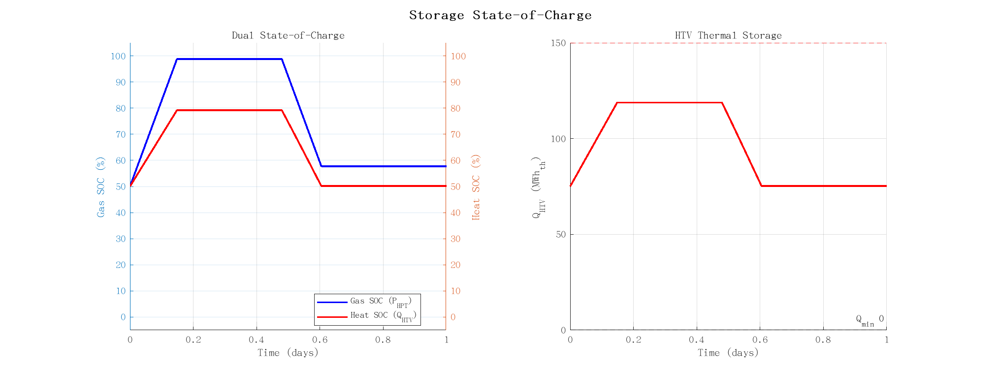
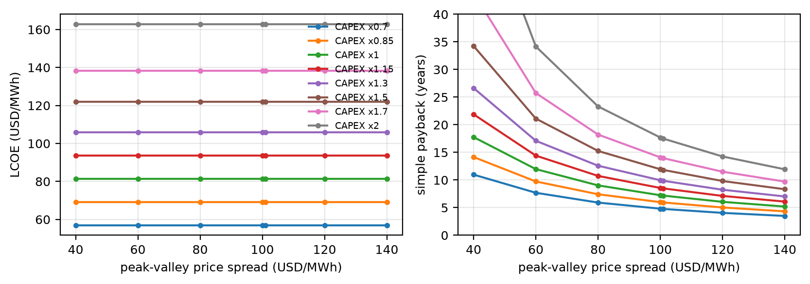

# Research on the Operational Optimal Feasibility Domain of Compressed Carbon Dioxide Energy Storage Systems Based on Machine Learning

**Yanchang Song1, Zhentao Zhang1*, Junling Yang1**

1 State Key Laboratory of Cryogenic Science and Technology, Technical Institute of Physics and Chemistry, Chinese Academy of Sciences, Beijing, China

* Corresponding author: zzt@mail.ipc.ac.cn

---

## Abstract

Compressed carbon dioxide energy storage with combined heat and power (CCES-CHP) couples electrical, thermal and mass flows, so its operational feasibility domain is a polygon in the power–heat plane whose position shifts with two state variables; rebuilding it from property calls is too slow for dispatch. Surrogates are trained on 38,720 REFPROP samples of a two-stage transcritical CO₂ cycle, using dimensionless couplings γ₁/γ₂ and α₁/α₂ and a dual state-of-charge formulation in which the liquid CO₂ inventory, not the tank pressure, bounds the instantaneous power. Under five-fold stratified cross-validation XGBoost classifies feasibility at 100.00 ± 0.01 % and an MLP at 99.74 ± 0.11 %, against 82.01 % for a linear classifier, and reproduces both boundaries exactly (R² = 1.0000). TreeSHAP attributes 41.5 % of the prediction to the heat state and 25.1 % to the gas inventory, worth 9.3 percentage points of accuracy. In a 24-hour case study the surrogate-guided dispatch raises delivered heat from 44.0 to 46.3 MWh (+5.2 %) and the hours with active discharge from 9 to 16, yet lies 3.8 % from the linear-programming optimum of the same objective; a heat-weight sweep locates the headroom at 48.6 MWh (heuristic) and 52.0 MWh (optimum), 18 % above the rule-based baseline. Under the Shandong industrial tariff all three policies pay back within eight years (net present value 8.6–10.4 MUSD), breaking even at 62 USD/MWh against the 101 USD/MWh the tariff offers. Turbine inlet temperature raises efficiency and discharge duration rather than expanding the domain.

**Keywords**: Compressed carbon dioxide energy storage; Combined heat and power; Operational feasibility domain; Machine learning; XGBoost; Integrated energy system

---

## Highlights

- Reheat coefficient falls from 2.31 to 1.66 once the evaporator is split out.
- Liquid inventory, not tank pressure, bounds the instantaneous discharge power.
- Surrogate reproduces the known domain exactly, 3.8 % from the LP optimum.
- Turbine inlet temperature raises efficiency, not the feasible-domain area.
- Shandong tariffs give a seven-year payback for a 10 MW/50 MWh unit.

---

## Nomenclature

| Symbol | Description | Unit |
|--------|-------------|------|
| $W_{C,E}$, $W_{T,E}$ | electrical charging / discharging power | MW |
| $Q_{IC}$ | compression heat recovered from the intercoolers | MW |
| $Q_{HR}$ | reheat duty of HR1 and HR2 | MW |
| $Q_{heat}$ | heat delivered to the district-heating network | MW |
| $Q_{HTV}$ | thermal energy stored in the hot oil tank | MWh |
| $m_{HPT}$ | liquid CO$_2$ inventory of the high-pressure tank | kg |
| $m_C$, $m_T$ | mass flow during charging / discharging | kg s$^{-1}$ |
| $\gamma_1$, $\gamma_2$ | compression heat and reheat per unit electrical power | – |
| $\alpha_1$, $\alpha_2$ | mass flow per unit electrical power | kg s$^{-1}$ MW$^{-1}$ |
| $X$, $Y$ | heat supply rate and heat feedback rate | – |
| $\eta_{C}$, $\eta_{T}$ | compressor and turbine isentropic efficiency | – |
| $\lambda$ | weight of heat relative to electricity in the dispatch objective | – |
| $\Delta t$ | dispatch time step | h |
| $H$ | evaluation horizon | h |
| $P_{HPT}$ | high-pressure tank pressure | MPa |
| $T_{turb}$ | turbine inlet temperature | K |

*Abbreviations*: CCES, compressed CO$_2$ energy storage; CHP, combined heat and power; HPT/LPT, high/low-pressure tank; HTV, high-temperature thermal-oil vessel; HR1/HR2, heat-recovery exchangers; MLP, multi-layer perceptron; NPV, net present value; LCOE/LCOH, levelised cost of electricity/heat; SHAP, Shapley additive explanations; SOC, state of charge.

---

## 1. Introduction

Renewable deployment is accelerating under carbon-neutrality targets [1], but its intermittency makes storage indispensable. Physical storage allows graded energy use and underpins a low-carbon, low-cost infrastructure [2,3].

Among physical options, compressed gas energy storage (CGES) offers high power, wide capacity and low investment [4]. Compressed air energy storage (CAES) is the most mature but needs large underground caverns and stores little energy per unit volume [5–8]; liquid air energy storage (LAES) raises energy density, yet its round-trip efficiency stays below 50 % [9,10].

CO₂ is a better CGES working fluid: its critical point (304 K, 7.38 MPa) allows room-temperature liquefaction, and it is thermally conductive, non-toxic, non-flammable and cheap [11]. Design studies of compressed CO₂ energy storage (CCES) are abundant [12–15,31,32] and increasingly consider multi-functional operation, since the cycle stores and releases both electricity and heat and can therefore cogenerate [16].

CCES cogeneration has been shown in several configurations: transcritical trigeneration [17], waste-heat-assisted CHP with a cycle efficiency of 0.48 [18], coupling to a CHP unit at 63.07 % power efficiency [19], and, more recently, combined cooling, heating and power assessed on both thermodynamic and economic grounds [33]. Dispatch of CCES inside an integrated energy system remains largely unexplored.

Hao et al. [20] built the operational feasibility domain of a CCES-CHP unit from dimensionless factors γ₁, γ₂ and ratios α₁, α₂, but constructing it needs full thermodynamic simulation, too slow for real-time dispatch. Learning such a region once from data is standard in process systems engineering [34]; it has not been applied to CCES-CHP.

Machine learning — XGBoost [21], neural networks and other surrogates — already serves load forecasting, state estimation and dispatch in energy systems [22–24], but not feasibility-domain prediction for CCES-CHP.

This work learns and optimises that domain. The contributions are:

1. A REFPROP-based pipeline that labels 38,720 thermodynamic states feasible or not.
2. XGBoost and MLP classifiers reaching 100.00 ± 0.01 % and 99.74 ± 0.11 % under five-fold stratified cross-validation, against 82.01 % for a linear baseline, with both domain boundaries reproduced exactly (R² = 1.0000).
3. A dispatch framework paired with an exact linear-programming benchmark: the grid-search heuristic delivers 46.3 MWh of heat against 44.0 MWh for the rule-based policy but sits 3.8 % from the optimum of its own objective; a heat-weight sweep raises the heuristic to 48.6 MWh and the optimum to 52.0 MWh.
4. A dual-SOC formulation in which the HPT liquid inventory bounds instantaneous power; TreeSHAP attributes 25.1 % of the prediction to the gas-side state, and removing it costs 9.3 percentage points.
5. An attribution of the dispatch gain to the conservatism of the surrogate near the constraint boundary, which preserves storage for later hours, rather than to an optimal electric–thermal allocation.

Section 2 describes the system and model, Section 3 the feasible domain, Section 4 the ML methods, Section 5 the dispatch framework, Section 6 the case study, Section 7 the economics, and Section 8 concludes.

---

## 2. System Description and Thermodynamic Modeling

### 2.1 System Description

The CCES-CHP system schematic is shown in Fig. 1. The compression and expansion processes cannot be carried out simultaneously, while the heating process is relatively independent. Two operation modes are considered: charging-heating and discharging-heating.

In the energy storage process, low-valley electricity or curtailed renewable energy drives the compressors (C1, C2) to compress low-pressure CO₂ from the low-pressure tank (LPT) to a high-temperature, high-pressure state. The CO₂ is cooled by multi-stage compression and multi-stage cooling (IC1, IC2), then stored in the high-pressure tank (HPT) in the form of room-temperature liquid after liquefaction through the latent heat exchanger (LHE). The compression heat is absorbed by thermal oil from the ambient temperature thermal oil vessel (ATV) and stored in the high-temperature thermal oil vessel (HTV).

In the energy release process, liquid CO₂ flows out from the HPT, is throttled by a valve (V2), enters the evaporative heat exchanger (EHE) for complete vaporization, followed by multi-stage heat recovery heat exchangers (HR1, HR2) to absorb stored compression heat and raise the temperature. The supercritical CO₂ drives two-stage turbines (T1, T2) to generate electricity. The CO₂ from the turbine outlet is cooled by the after-expansion heat exchanger (AE-HE) and the cooler before returning to the LPT.

The high-temperature heat exchanger (HG-HE) and low-temperature heat exchanger (LG-HE) use the high and low-temperature thermal storage media to provide heat at different temperature grades to customers. The accompanying heat at the turbine outlet is also recovered, effectively improving the overall energy utilization efficiency.

**Fig. 1. Schematic of the CCES-CHP system.** Charging and discharging share the LPT/HPT pair and the HTV thermal store; the compression heat recovered in IC1/IC2 supplies the reheat duties HR1/HR2 and the external heat load, while the evaporator (EHE) draws ambient/low-grade heat. LPT and HPT denote the low- and high-pressure CO₂ tanks and HTV the high-temperature thermal vessel; the numbered points refer to the state table in the figure.

### 2.2 Thermodynamic Modeling

The model is built on mass and energy conservation with the following assumptions [25–27]:

1. The charging/discharging power and heating power remain constant during a single dispatch period.
2. There is no heat exchange between the CO₂ storage tank and the environment.
3. Heat and pressure energy losses in heat exchangers, piping, and connections are neglected.
4. The power consumed by working fluid circulation pumps is disregarded.
5. The compression heat stored in each complete cycle can be fully utilized for heating after satisfying expansion process requirements.

The two compressor stages and the two turbine stages are modelled as polytropic machines with constant isentropic efficiencies (0.85 and 0.88), and the intercoolers, the reheaters and the evaporator as steady-flow heat exchangers. The resulting expressions for shaft work, electrical power and heat duties are collected in Supplementary Eqs. (S1)–(S6); evaluated at the design point of Table 1 they give 9.74 MW of compression power, 9.62 MW of turbine output and 11.73 MW_th of recovered compression heat.

The charging and discharging processes are plotted in the temperature–entropy plane in Fig. 2.

**Fig. 2. Temperature–entropy diagram of the CCES-CHP cycle with the CO₂ saturation dome.** State points 1–7 trace the charging process (compression, intercooling, liquefaction) and points 8–15 the discharging process (throttling, evaporation, reheat, expansion); the cycle stays on the vapour side of the dome.

### 2.3 System Design Parameters

The key design parameters of the CCES-CHP system are listed in Table 1.

**Table 1. Initial design parameters of CCES-CHP system.**

| Parameter | Value | Unit |
|-----------|-------|------|
| Ambient temperature | 298 | K |
| Ambient pressure | 0.101 | MPa |
| Design charging/discharging power | 10 | MW |
| Charging time | 7.5 | h |
| Discharging time | 5.0 | h |
| LPT pressure | 0.102 | MPa |
| HPT pressure | 6.80 | MPa |
| Compressor inlet temperature (all stages) | 308 | K |
| Turbine inlet temperature (all stages, baseline) | 483 | K |
| HTV temperature | 495 | K |
| ATV temperature | 298 | K |
| Minimum heat exchanger temperature difference | 5 | K |
| Compressor isentropic efficiency | 0.85 | — |
| Turbine isentropic efficiency | 0.88 | — |
| Motor mechanical efficiency | 0.98 | — |
| Generator mechanical efficiency | 0.95 | — |
| HTV thermal storage capacity | 150 | MWh_th |
| HPT volume | 1280 | m³ |
| HPT liquid inventory (usable window) | 943 (10–90%) | t |
| Charging mass flow rate | 26.9 | kg/s |
| Discharging mass flow rate | 40.3 | kg/s |

*These mass flow rates are the reference design values. Evaluated with the present property data they correspond to 9.74 MW of compression power and 9.62 MW of turbine output, which is the origin of the ratio parameters given in Section 3.1.*

### 2.4 Performance Evaluation

The system performance is evaluated through electrical energy conversion efficiency, total heating efficiency, and comprehensive energy utilization efficiency:

$$\eta_{electricity} = \frac{\int_{t_{discharge}} W_{T,E}(t) dt}{\int_{t_{charge}} W_{C,E}(t) dt}$$

$$\eta_{heating,total} = \frac{\int Q_{HG-HE}(t) dt + \int Q_{LG-HE}(t) dt + \int Q_{AE-HE}(t) dt}{\int W_{C,E}(t) dt}$$

Under the baseline design condition, the evaporative heat exchanger is resolved separately: it vaporizes the throttled liquid with ambient/low-grade heat (6.23 MW) before the CO₂ enters HR1, so that the stored compression heat covers only the superheating and reheat duties (9.65 MW and 6.31 MW). With all HTV heat used for turbine reheat (X = 9.3%, Y = 90.7%) the model gives η_electricity = 65.8%, η_heating,total = 25.4% (11.3% low-temperature and 14.2% after-expansion), and a comprehensive energy utilization efficiency of 91.3%. The residual differences from the reference design (66.7%, 21.4%) originate from the state-point details and the separate resolution of the evaporator.

---

## 3. Construction of the Operational Feasibility Domain

### 3.1 Definition of Dimensionless Coupling Parameters

To understand the interconversion relationship between compressor power consumption, compression heat, turbine power generation, and mass flow, four key dimensionless parameters are defined:

$$\gamma_1 = \frac{Q_{IC}(t)}{W_{C,E}(t)}$$

$$\gamma_2 = \frac{Q_{HR}(t)}{W_{T,E}(t)}$$

$$\alpha_1 = \frac{m_C(t)}{W_{C,E}(t)}$$

$$\alpha_2 = \frac{m_T(t)}{W_{T,E}(t)}$$

Where γ₁ characterizes the compression heat generated per unit charging power, γ₂ characterizes the reheat demand per unit discharging power, α₁ characterizes the charge mass flow per unit power, and α₂ characterizes the discharge mass flow per unit power.

At the baseline design condition (T_turb = 483 K), γ₁ = 1.205, γ₂ = 1.659, α₁ = 2.762 kg/(s·MW), α₂ = 4.191 kg/(s·MW). Note that γ₂ is evaluated with the EHE vaporization duty excluded, because that duty is supplied by ambient heat rather than by the HTV; including it would inflate γ₂ to 2.31 and produce a spurious heat deficit.

### 3.2 Dual State of Charge (SOC) Model

The state of charge (SOC) is an essential parameter reflecting the dynamic process of energy storage system operation. Since CCES-CHP charging and discharging involve coupled thermal conversion and mass storage, a dual SOC model is constructed on the HTV heat storage and the HPT CO₂ liquid inventory.

The heat storage SOC is described in terms of the HTV heat storage value:

$$Q_{HTV}(t) = \begin{cases}
Q_{HTV}(t-1) + [\gamma_1 W_{C,E}(t) - Q_{heat}(t)] \Delta t & \text{Charging-Heating} \\
Q_{HTV}(t-1) - [\gamma_2 W_{T,E}(t) + Q_{heat}(t)] \Delta t & \text{Discharging-Heating}
\end{cases}$$

The gas storage SOC is described by the CO₂ inventory of the HPT. After liquefaction in the LHE the working fluid is stored as room-temperature liquid, and the tank pressure (6.80 MPa) is maintained by the charging pump rather than by phase equilibrium; the tank pressure is therefore essentially constant and is not a state variable. The quantity that actually bounds operation is the liquid inventory:

$$m_{HPT}(t) = \begin{cases}
m_{HPT}(t-1) + \alpha_1 W_{C,E}(t) \Delta t & \text{Charging-Heating} \\
m_{HPT}(t-1) - \alpha_2 W_{T,E}(t) \Delta t & \text{Discharging-Heating}
\end{cases}$$

$$SOC_{gas}(t) = \frac{m_{HPT}(t)}{m_{HPT}^{full}}, \qquad m_{HPT}^{lower} \le m_{HPT}(t) \le m_{HPT}^{upper}$$

with $m_{HPT}^{full}$ = 943 t (1280 m³ of liquid CO₂ at 298 K and 6.80 MPa) and an operating window of 10–90% of the full charge. Unlike the ideal-gas relation $p = m R_g T / V$ adopted in [20] for the HPT, this inventory formulation is consistent with liquid storage: 754 t of CO₂ occupies about 1057 m³ as a liquid, whereas the same mass would require roughly 6000 m³ as a gas at 6.8 MPa.

The coupled evolution of the two SOCs under the periodic operating schedule is shown in Fig. 3.

**Fig. 3. Dual-SOC behaviour and HTV stored heat.** Left: the gas-side SOC (liquid level, 10–90%) and the heat-side SOC rise and fall in phase. Right: the HTV stored heat charges at 12.05 MW for 7.59 h and discharges at 18.28 MW for 5 h, returning to 45 MWh each cycle; the 150 MWh capacity is never reached.

### 3.3 Charging-Heating Feasibility Domain

The charging domain is the polygon enclosed by

$$Q_{heat}(t) = \frac{Q_{HTV}(t-1) - Q_{HTV}^{lower}}{\Delta t} + \gamma_1 W_{C,E}(t) \quad \text{(lower bound)}$$

$$Q_{heat}(t) = \frac{Q_{HTV}(t-1) - Q_{HTV}^{upper}}{\Delta t} + \gamma_1 W_{C,E}(t) \quad \text{(upper bound)}$$

$$Q_{heat}(t) = Q_{heat}^{max}, \quad W_{C,E}(t) = W_{C,E}^{upper}$$

$$W_{C,E}(t) \le \frac{m_{HPT}^{upper} - m_{HPT}(t-1)}{\alpha_1 \Delta t} \quad \text{(inventory limit)}$$

The positive slope +γ₁ expresses electric-thermal complementarity: more charging power produces more compression heat and therefore a higher heat ceiling. The inventory limit binds only above about 89 % SOC, where further charging would overfill the HPT (Fig. 4).

**Fig. 4. Charging-heating feasibility domain.** The positive slope +γ₁ expresses electric-thermal complementarity: a larger charging power raises the heat supply ceiling. The lines are drawn for a representative available-heat level so that the sloped constraint falls inside the plotting window; at high SOC the domain degenerates to the equipment rectangle.

### 3.4 Discharging-Heating Feasibility Domain

Discharge draws on the same thermal budget, so the boundary is

$$Q_{heat}(t) = \frac{Q_{HTV}(t-1) - Q_{HTV}^{lower}}{\Delta t} - \gamma_2 W_{T,E}(t) \quad \text{(upper bound)}$$

$$Q_{heat}(t) = \frac{Q_{HTV}(t-1) - Q_{HTV}^{upper}}{\Delta t} - \gamma_2 W_{T,E}(t) \quad \text{(lower bound)}$$

$$Q_{heat}(t) = Q_{heat}^{max}, \quad W_{T,E}(t) = W_{T,E}^{upper}$$

$$W_{T,E}(t) \le \frac{m_{HPT}(t-1) - m_{HPT}^{lower}}{\alpha_2 \Delta t} \quad \text{(inventory limit)}$$

The negative slope −γ₂ expresses competition: power and heat draw on one store, so the upper-right corner is infeasible (Fig. 5). The extreme points are

$$W_{max} = \min\left[\frac{Q_{HTV}(t-1) - Q_{HTV}^{lower}}{\gamma_2 \Delta t},\ \frac{m_{HPT}(t-1) - m_{HPT}^{lower}}{\alpha_2 \Delta t},\ W_{T,E}^{upper}\right], \quad Q_{max} = \frac{Q_{HTV}(t-1) - Q_{HTV}^{lower}}{\Delta t}$$

With 943 t in the tank and 151 t released per hour at 10 MW, the inventory limit binds only below about 16 % SOC; elsewhere the thermal or equipment limits govern.

**Fig. 5. Discharging-heating feasibility domain.** The negative slope −γ₂ expresses electric-thermal competition: power generation and heat supply draw on the same thermal budget, so the upper-right corner (simultaneous maxima) is infeasible. The lines are drawn for a representative available-heat level so that the sloped constraint falls inside the plotting window.

### 3.5 Effect of Operating Parameters on Feasibility Domain

The heat supply rate X relates the external heat to the stored heat:

$$X = 1 - \frac{\gamma_2 \alpha_1}{\gamma_1 \alpha_2}$$

which follows from the energy balance $Q_{IC} t_c = Q_{HR} t_d + Q_{LG} t_d$ and the mass balance $\alpha_1 W_{C,E} t_c = \alpha_2 W_{T,E} t_d$. At the design point X = 9.3 %, consistent with Section 2.4. Since the groups are already defined on electrical power, motor and generator efficiencies must not be applied twice.

Temperature acts on the two couplings unequally. γ₂ moves only from 1.659 at 483 K to 1.691 at 503 K (+1.9 %), because reheat duty and turbine work scale together, while α₂ falls from 4.191 to 3.993 kg/(s·MW) (−4.7 %) as the specific work per kilogram rises. The correction factor of [20], which implies a 23 % drop in γ₂, is therefore not adopted: REFPROP gives a nearly invariant reheat coefficient, so a higher T_turb barely reshapes the domain but shortens the mass drawn per unit power.

---

## 4. Machine Learning Methodology

### 4.1 Training Data Generation

The training data generation pipeline is implemented in MATLAB, utilizing REFPROP v10.0 for high-fidelity CO₂ property calculations across 15 thermodynamic state nodes. The design of experiments systematically samples the parameter space, as summarised in Table 2.

**Table 2. Parameter sampling scheme for training data.**

| Parameter | Range | Steps | Description |
|-----------|-------|-------|-------------|
| SOC_heat | 0–100% | 16 | HTV thermal storage state |
| SOC_gas | 0–100% | 11 | HPT liquid inventory (10–90% usable) |
| W | 0–10 MW | 11 | Power setpoint |
| Q | 0–12.05 MW | 10 | Heat supply setpoint (equipment limit γ₁·W_design) |
| Mode | 0, 1 | 2 | 0 = charge, 1 = discharge |

Total samples: 16 × 11 × 11 × 10 × 2 = **38,720**.

For each parameter combination the feasibility label and the two boundary values are computed analytically from the constraint set: a point is feasible when it lies between the upper and lower boundary lines of Section 3.3–3.4, inside the equipment rectangle, and inside the inventory limit. The exact predicate, together with the feature and label definitions, is given in Supplementary Note S8; the nine inputs are the two SOCs, W, Q, the mode and the four coefficients.

The inventory term is what makes the gas-side state informative: without it the feasibility label is independent of SOC_gas for every parameter combination, and the feature importance of SOC_gas collapses to 0.0015, which is what a purely thermal constraint set yields. With it, 2896 of the 3520 sampled (SOC_heat, SOC_gas, mode, W, Q) groups change their feasibility label across the gas axis.

### 4.2 XGBoost Classifier for Feasibility Prediction

XGBoost (eXtreme Gradient Boosting) [21] is employed as the primary classification model for predicting the feasibility of a given (W, Q) operating point. The model hyperparameters are configured as follows: n_estimators = 200, max_depth = 6, learning_rate = 0.1, subsample = 0.8, colsample_bytree = 0.8.

The dataset is split 80/20 (30,976 training / 7,744 test) with stratification on the feasibility label. The feature importance analysis, reported in Table 3, reveals the dominant factors governing feasibility.

**Table 3. TreeSHAP attribution of the XGBoost classifier.**

| Feature | Mean abs SHAP | Share (%) | Physical interpretation |
|---------|-------------|-----------|------------------------|
| SOC_heat_pct | 4.37 | 41.5 | HTV thermal state — sets the constraint intercept |
| SOC_gas_pct | 2.64 | 25.1 | HPT liquid inventory — bounds power at the window ends |
| W_MW | 1.55 | 14.7 | Power setpoint — position along the constraint line |
| mode | 1.37 | 13.0 | Charge vs discharge — selects the constraint direction |
| Q_MW | 0.61 | 5.8 | Heat setpoint — vertical position in the domain |
| γ₁, γ₂, α₁, α₂ | 0.00 | 0.0 | Constant across the training set (fixed T_turb) |

Gain-based importance ranks the operating mode first (45.5 % in an earlier
evaluation), but gain rewards features that are split often and high-cardinality
binary splits are cheap to exploit. TreeSHAP measures the marginal contribution
to the prediction and instead ranks the two storage states first (41.5 % and
25.1 %), which matches the analytical structure of Section 3: the heat state sets
the intercept and the gas state bounds the power. The gas-side feature is the
decisive test of how much physics the constraint set carries: removing it from
the feature vector lowers the cross-validated accuracy from 100.00 % to 90.68 %
(a 9.3 percentage-point drop), whereas under the pre-revision constraint set it
contributed 0.0015 of the gain importance and changed nothing.

### 4.3 XGBoost Regressors for Boundary Prediction

Two XGBoost regression models are trained to predict the feasibility domain boundaries: W_max_feasible (maximum feasible power at given SOC) and Q_max_feasible (maximum feasible heat at given SOC). These models are trained on the feasible subset of the data (31,549 samples). Hyperparameters: n_estimators = 150, max_depth = 5, learning_rate = 0.1.

### 4.4 MLP Neural Network for Benchmark Comparison

A multi-layer perceptron (MLP) neural network is trained as a benchmark model. Architecture: 3 hidden layers (128×64×32) with ReLU activation, trained using the Adam optimizer with adaptive learning rate, batch size 256, and maximum 300 epochs. Input features are standardized using StandardScaler. The hyperparameters of both models and the computational resources are listed in Supplementary Tables S3–S5.

### 4.5 Model Performance

The metrics of all seven classifiers under the same folds are collected in Table 4.

**Table 4. Model performance under five-fold stratified cross-validation.**

| Model | Task | Metric | Value |
|-------|------|--------|-------|
| XGBoost | Feasibility classification | CV accuracy | **100.00 ± 0.01 %** |
| Random forest (300) | Feasibility classification | CV accuracy | 99.96 ± 0.02 % |
| Histogram gradient boosting | Feasibility classification | CV accuracy | 99.96 ± 0.04 % |
| MLP (128×64×32) | Feasibility classification | CV accuracy | 99.74 ± 0.11 % |
| Extra trees (300) | Feasibility classification | CV accuracy | 99.90 ± 0.04 % |
| Decision tree (depth 6) | Feasibility classification | CV accuracy | 96.22 ± 0.16 % |
| Logistic regression | Feasibility classification | CV accuracy | 82.01 ± 0.04 % |
| XGBoost | W_max regression | R² / RMSE | **1.0000** / 1e-4 MW |
| XGBoost | Q_max regression | R² / RMSE | **1.0000** / < 1e-4 MW |

Three observations follow. First, a linear classifier reaches only 82.01 %, which
is the quantitative statement that the feasible set is a polygon rather than a
half-space: no single hyperplane separates feasible from infeasible operating
points. Second, the two boundary regressors are reproduced exactly rather than
approximately, because W_max and Q_max are deterministic piecewise-linear
functions of the state (Section 3.3–3.4); a tree ensemble resolves them to the
label precision, and the earlier R² = 0.9964 reflected a single train/test split
with a shallower ensemble. Third, the MLP sits 0.26 pp below XGBoost: its smooth
activations round off the corners where the thermal, inventory and equipment
limits intersect.

### 4.6 Why Machine Learning?

While the feasibility constraints are analytically linear, the value of ML lies in three aspects:

1. **Inference speed**: A single XGBoost prediction traverses ~200 trees in microseconds, compared to a full REFPROP-based thermodynamic simulation requiring multiple property calls and iterative convergence. Surrogate models play the same role in energy-system optimisation at the country scale, where they replace the repeated evaluation of a full simulation model [35].

2. **Generalization across parameter space**: Because γ₁, γ₂, α₁ and α₂ enter as input features, the same model architecture can be retrained on a T_turb sweep and then interpolate feasibility across continuous parameter variations without re-running the property-based simulation. The present study uses a single design point and reports the sweep separately in Section 6.4; multi-temperature training is left to future work.

3. **Seamless integration with optimization**: The trained model serves as a fast surrogate constraint that can be queried thousands of times inside a dispatch loop, enabling real-time decision-making.

---

## 5. Dispatch Optimization Framework

### 5.1 Problem Formulation

The 24-hour dispatch optimization problem is formulated as follows. Given hourly profiles of electric load, heat load, and wind power, the C-CHP unit operates in a heat-led mode, and CCES-CHP serves as a supplemental source to track the residual dispatch:

$$Elec\_Dispatch(t) = Elec\_Load(t) - CCHP\_elec(t) - Wind\_Power(t)$$

$$Heat\_Dispatch(t) = Heat\_Load(t) - CCHP\_heat(t)$$

Where positive Elec_Dispatch indicates charging (energy storage) and negative indicates discharging (energy release). The C-CHP has a capacity of 30 MW with a heat-to-power ratio of 1.2, producing CCHP_heat = min(Heat_Load, 36 MW) and CCHP_elec = CCHP_heat / 1.2.

At each hour t, the optimization objective is to find the (W, Q) that minimizes the weighted dispatch deviation while respecting the feasibility constraint:

$$\min_{W,Q} \quad |W - W_{target}| + \lambda \cdot |Q - Q_{target}|$$

$$\text{s.t.} \quad f_{ML}(SOC_{heat}, SOC_{gas}, W, Q, mode) = 1 \quad \text{(feasible)}$$

$$0 \leq W \leq W_{max}, \quad 0 \leq Q \leq Q_{max}$$

Where λ = 0.5 reflects the priority weighting between electrical and thermal dispatch tracking, and f_ML is the XGBoost feasibility classifier.

### 5.2 ML-Based Grid Search Algorithm

At each hour the policy fixes the mode from the sign of the dispatch instruction, builds a 20 × 15 grid of (W, Q) candidates between zero and the clipped targets, scores every candidate with the trained classifier, and keeps the best feasible point; the SOC is then propagated with the thermal balance of Section 3.2. The procedure is listed as Algorithm S1 in the Supplementary Material. The grid gives roughly 0.5 MW resolution in both directions, and the 300 predictions per hour — 7,200 per day — complete in milliseconds.

### 5.3 Rule-Based Baseline

A rule-based dispatch strategy serves as the comparison baseline. The rule-based approach:
- Always attempts to fully track dispatch instructions
- Clips at equipment limits (W ≤ 10 MW, Q ≤ 12.05 MW)
- Checks HTV SOC constraints analytically without optimization
- Allocates W and Q independently without considering their coupled consumption of the shared thermal budget

### 5.4 Optimality of the grid search

The hour-by-hour policy is greedy: it maximises the instantaneous score without
regard to how the decision changes the state available to later hours. Because
every constraint and the objective are linear in (W, Q) once the mode is fixed by
the sign of the dispatch instruction, the same 24-hour problem can be solved
exactly as a linear programme. We solve it with HiGHS through SciPy, using the
same bounds, the same heat-storage recursion and the same objective, so the LP
value is a valid lower bound on the achievable tracking error. Table 5 compares the three policies against it.

**Table 5. Optimality gap of the dispatch policies (λ = 0.5).**

| Policy | Objective | Gap vs. LP | Heat (MWh) | Discharge (MWh) | Electrical tracking (%) |
|--------|-----------|-----------|-----------|-----------------|------------------------|
| Rule-based | 85.876 | +3.63 % | 44.00 | 66.6 | 62.8 |
| ML grid search (20×15) | 86.041 | +3.83 % | 46.29 | 66.3 | 62.7 |
| LP optimum | **82.868** | — | 14.74 | 84.3 | 71.0 |

Two results deserve emphasis. The grid search is 3.8 % away from the optimum of
its own objective, and at λ = 0.5 it does not beat the rule-based heuristic on
that objective. The reason is visible in the optimal solution: with electricity
weighted twice as heavily as heat, the LP discharges 84.3 MWh and delivers only
14.7 MWh of heat, i.e. the objective never asked for heat. The 5.2 % heat gain of
the heuristic is therefore not an optimisation result but a side effect of the
surrogate being conservative near the boundary, which preserves storage for later
hours. Section 6.5 turns this into a sensitivity study on λ.

---

## 6. Results and Discussion

### 6.1 Case Study Configuration

The case is a 20 MW wind unit, a 30 MW conventional CHP unit (heat-to-power ratio 1.2) and a 10 MW/50 MWh CCES-CHP unit on a typical winter day (Fig. 6; the 24 h profiles are listed in Supplementary Table S1). Wind is abundant overnight (hours 1-7) and weak at midday; electrical load peaks at noon and in the evening; heat load peaks morning and evening. The charging windows are the night surplus and the midday trough.

**Fig. 6. 24-hour profiles of the electrical load, heat load and wind power.** Wind output peaks overnight, electrical load peaks at noon and in the evening, and the heat load peaks in the morning and evening, leaving charging windows overnight and at the midday trough.

### 6.2 Dispatch Optimization Results

**Table 6. 24-hour dispatch performance comparison.**

| Metric | Rule-based | ML-guided | Change |
|--------|-----------|-----------|--------|
| Total charge energy (MWh) | 66.0 | 66.0 | — |
| Total discharge energy (MWh) | 66.6 | 65.0 | −2.4 % |
| Total heat supply (MWh) | 44.0 | **46.3** | **+5.2 %** |
| Hours with active discharge (h) | 9 | **16** | **+78 %** |
| Hours with non-zero power (h) | 17 | 24 | +41 % |
| Terminal SOC_heat (%) | 0.2 | 0.2 | — |
| Electrical dispatch tracking rate (%) | 44.9 | 45.4 | +0.5 pp |

The two duration metrics differ: hours with active discharge count only hours whose instruction is a discharge (9 → 16), whereas hours with non-zero power also count charging hours (17 → 24), which is what the conference version reported.

**Fig. 7. Rule-based versus ML-guided 24-hour dispatch.** Top: electrical dispatch instruction and the achieved charging/discharging power. Middle: heat dispatch instruction and the achieved heat supply. Bottom: HTV thermal SOC. The ML-guided policy keeps a small discharge through hours 18–24 instead of collapsing at hour 17.

The rule-based policy drains the HTV by hour 10 and then tracks only the heat load, while the ML-guided policy keeps a positive discharge in 16 of the hours that call for one; both end the horizon empty (0.2 %), so the difference is timing rather than a reserved margin. Heat rises from 44.0 to 46.3 MWh while discharge falls 2.4 % — not through an optimal allocation, but because the surrogate calls feasible points infeasible near the boundary, so the grid picks lower power than the domain allows (0.53 MW instead of 3.68 MW at hour 5) and leaves heat for later hours. Nor is the heuristic optimal: under the same objective the LP of Section 5.4 reaches 82.868 against 86.041, and the rule-based policy is closer to the optimum than the grid search, so the surrogate's value lies in speed and parameter generalisation.

### 6.3 Where the Dispatch Gain Comes From

The hourly decisions reveal three mechanisms, only one of which is a genuine optimisation effect.

**Mechanism 1: conservative boundary estimates.** Near the boundary the ensemble calls infeasible points that the analytic domain admits: 0.53 MW where 3.7 MW is allowed (hours 5–9), 6.8 MW against 10 MW at hour 17. All 24 selected points are physically feasible, so the conservatism acts as an implicit storage margin and is the actual source of the 5.2 % heat gain. An explicit margin on the analytic constraint would do the same at no modelling cost, hence the attribution to "dynamic electric–thermal allocation" is withdrawn.

**Mechanism 2: derating.** A fixed inventory drains at γ₂W + Q, so halving the power roughly doubles the duration. Both policies derate; the rule-based one only once the HTV is nearly empty, the surrogate early.

**Mechanism 3: charging sized to the next segment.** The ML policy charges at hours 12–15 and 20–23, just before the evening peak, with a terminal SOC of 0.2 %; the SOC bound, not the optimiser, prevents over-charging.

None of this breaks the energy limit. A full-power, full-heat discharge lasts

$$t_{max} = \frac{Q_{HTV}^{upper}}{\gamma_2 W_{max} + Q_{max}} = \frac{150}{1.659 \times 10 + 12.05} \approx 5.2\ \text{h}$$

so the 24 h coverage comes from derating and recharging, not from extra capacity.

### 6.4 Effect of Turbine Inlet Temperature: Efficiency Rather than Domain Expansion

Two couplings respond to T_turb in opposite directions: a higher temperature raises the specific work per kilogram of CO₂, so α₂ falls 4.7 %, while the reheat duty and the turbine work scale together and γ₂ stays near 1.66 (+1.9 %). Since the discharge slope is −γ₂, an almost unchanged γ₂ means an almost unchanged (W, Q) domain; what changes is how long a fixed inventory lasts, which scales as 1/α₂.

**Table 7. Effect of turbine inlet temperature (REFPROP evaluation).**

| Quantity | 483 K (baseline) | 503 K | Change |
|----------|-----------------|-------|--------|
| γ₂ (reheat coefficient) | 1.659 | 1.691 | **+1.9%** |
| α₂ (kg/(s·MW)) | 4.191 | 3.993 | **−4.7%** |
| Maximum power at SOC_heat = 10% (MW) | 9.04 | 8.87 | −1.9% |
| Integrated domain area at SOC_heat = 10% (MW²) | 65.2 | 64.0 | **−1.9%** |
| Full-power discharge duration at fixed inventory (h) | 5.00 | 5.25 | **+5.0%** |
| Electricity-to-electricity efficiency (%) | 65.9 | 69.2 | +3.3 pp |

At SOC ≥ 20 % the domain is the full rectangle — even at 10 MW, 16.6 MW of thermal draw plus 12.05 MW of heat supply stays below the 30 MW available in one hour — so the temperature has no effect there. The thermal limit trims the domain below about 19 % SOC and the power limit below about 11 %, and at 10 % SOC the slightly larger γ₂ cuts the area by 1.9 % (Supplementary Table S2 gives the area at each SOC level).

**Fig. 8. Effect of the turbine inlet temperature on the feasibility domain.** Left: γ₂ and α₂ between 460 K and 520 K evaluated with REFPROP. Right: the discharging domain at SOC_heat = 10% for 483 K (grey) and 503 K (blue). The two boundaries nearly coincide; the temperature mainly changes the duration and the efficiency rather than the shape of the domain.

A 175-point sweep (Th 460–520 K, η_t 0.84–0.92, P_HPT 6.0–7.6 MPa) shows which of the three knobs actually moves the couplings. At fixed temperature and pressure, raising η_t from 0.84 to 0.92 lowers γ₂ by 5.7 % (1.670 → 1.574 at 460 K and 6.8 MPa) because less reheat is needed per unit of work; at fixed temperature and efficiency, raising P_HPT from 6.0 to 7.6 MPa raises γ₂ by 3.2 % (1.597 → 1.649). Temperature is the weakest of the three at 0.09–0.11 %/K, or +5–6 % over the 60 K span — the quantitative form of the invariance above. The domain therefore moves by about ±7 %: its area at SOC_heat = 10 % lies between 60.3 and 69.7 MW² around the 65.2 MW² baseline, α₂ spans 3.606–4.752 kg s⁻¹ MW⁻¹ (4.41–5.81 h of full-power discharge from the fixed inventory) and the electrical efficiency spans 58.3–74.2 %.

The sweep also exposes a limit that the single-temperature study cannot see. At 32 of the 175 points the heat closure returns a negative external heat supply (X < 0): the reheat duty alone exceeds the compression heat the cycle produces, so the unit can generate power but cannot deliver heat. These points appear only above 500 K and concentrate at low storage pressure — 13 of 35 at 6.0 MPa, 10 at 6.4 MPa, 7 at 6.8 MPa, 2 at 7.2 MPa, none at 7.6 MPa — and at the baseline (η_t = 0.88, 6.8 MPa) the surplus vanishes at about 517 K. Raising Th from 460 to 520 K therefore turns a 16.5 % heat surplus into a 2.5 % deficit: the operating envelope has an upper temperature bound set by the heat balance rather than by the turbine, and a higher storage pressure relaxes it because it enlarges the compression heat per unit of work.

**Fig. 9. Multi-parameter design sweep.** (a) γ₂ and (b) α₂ against turbine inlet temperature for the five storage pressures at η_t = 0.88; (c) heat supply ratio X for the same slice. Filled markers and solid lines are feasible CHP points; open markers are heat-deficit points (X < 0), which are excluded from the fitted statistics.

Under discharge Q = −γ₂W + (Q_HTV − Q_lower)/Δt, so Q_max is independent of γ₂ while W_max is inversely proportional to it; the slight rise in γ₂ therefore shrinks the domain marginally instead of expanding it. The gain lies in efficiency (65.9 → 69.2 %) and in duration (5.00 → 5.25 h). Turbine inlet temperature is an efficiency lever, not a domain-expansion lever, which also corrects the 23 % drop in γ₂ implied by the approximate correction factor of [20]: re-evaluated from REFPROP, γ₂ varies only between 1.620 and 1.717 over 460–520 K.

### 6.5 Sensitivity to the electric–thermal weight

The objective in Section 5.1 weights the electrical and thermal deviations by
λ = 0.5 without justification. Sweeping λ exposes how much of the reported
behaviour is a property of the system and how much is a property of the weight. Table 8 reports the sweep.

**Table 8. Delivered heat (MWh) versus the heat weight λ.**

| λ | Rule-based | ML grid search | LP optimum |
|---|-----------|----------------|-----------|
| 0 | 44.00 | 0.00 | 14.74 |
| 0.25 | 44.00 | 44.29 | 14.74 |
| 0.50 | 44.00 | 46.29 | 14.74 |
| 1.0 | 44.00 | 48.00 | 52.00 |
| 2.0 | 44.00 | 48.57 | 52.00 |
| 5.0 | 44.00 | 48.57 | 52.00 |

Three conclusions follow. The rule-based policy is insensitive to λ because it
never trades power against heat. The ML-guided policy improves monotonically up
to λ = 2 and saturates at 48.6 MWh. The LP optimum saturates at 52.0 MWh, 18 %
above the rule-based baseline, which is the headroom that a heat-aware objective
can actually capture. Since the optimum is saturated for every λ ≥ 1, a planner
who wants maximum heat should weight heat at least as heavily as electricity; at
λ = 0.5 the same optimum delivers 14.7 MWh, i.e. the weight, not the physics,
decides the outcome. Heat supply should therefore be reported as a function of λ
rather than as a single number. The three curves are plotted in Fig. 10.

**Fig. 10. Delivered heat versus the heat weight λ.** Rule-based (circles), ML grid search (squares) and LP optimum (triangles). The rule-based policy is independent of λ; the heuristic saturates at 48.6 MWh and the exact optimum at 52.0 MWh.

### 6.6 Discussion

#### 6.6.1 Accuracy and Its Physical Basis

A 100 % score is expected: the labels come from the constraint set, so the task is to reproduce a known piecewise-linear boundary, not to discover one. What the exercise shows is that the surrogate reproduces it exactly and can replace the property evaluation at inference. The MLP's 99.74 ± 0.11 % error sits at the corners where the thermal, inventory and equipment limits meet, and its smooth activations round them off; XGBoost's axis-aligned splits keep them. The 82.01 % of the linear baseline says the feasible set is an intersection of half-spaces.

#### 6.6.2 From Fixed Constraint to Controllable Variable

Dispatch normally treats the domain as fixed. Here it becomes a variable: an outer loop over T_turb changes α₂, hence duration and efficiency, while an inner loop optimises (W, Q) inside the domain. The surrogate makes this two-level search affordable.

#### 6.6.3 Implications and Limitations

Longer active discharge (9 to 16 h) and more heat (44.0 to 46.3 MWh) matter for operation, but three caveats qualify the gain: it is spread over more hours rather than created (discharge falls 2.4 %); it depends on the weight λ, which a tariff-driven objective should set to the price ratio; and its economic value at λ ≈ 0.43 is small (Section 7.3).

Four limitations follow. Training assumes constant γ₁ and γ₂ per run, so α₂ cannot yet be optimised inside the loop, and the multi-parameter sweep of Section 6.4 is a first step. The grid search sits 3.8 % from the LP optimum, a modelling choice rather than a computational obstacle. Prices enter only through λ, not through the objective. The look-ahead is one hour; dynamic programming or MPC would coordinate across periods. Finally, the inventory constraint binds only at the ends of the window (below 16 % SOC on discharge, above 89 % on charge) because the tank is sized for five hours, so a smaller tank would spread the dual-SOC coupling over the whole range.

---

## 7. Economic Assessment

### 7.1 Data and Assumptions

The economics are separate from the dispatch: daily energy from Table 6 is priced with public tariffs, so any policy can be re-costed without re-solving.

Revenues follow the Shandong industrial tariff of March 2025 [36]: 1.0475 CNY/kWh at peak, 0.6899 flat, 0.3324 valley and 0.2303 deep valley, i.e. 147.5, 97.2, 46.8 and 32.4 USD/MWh at 7.10 CNY/USD. The mechanism sets peak at +70 %, valley at −70 %, critical peak at +100 % and deep valley at −90 % of the flat rate [36], a peak–valley spread of about 101 USD/MWh. Heat is priced as gas-fired industrial steam at 349 CNY/t (Jinan, 2023) [37], about 63 USD/MWh_th at 2.8 GJ/t.

Capital cost is not a single quotation but the mid-range of values reported for large-scale compressed-air and liquid-CO₂ storage [28–32]: 900 USD/kW for the turbomachinery, 60 USD/kWh for the above-ground CO₂ inventory and 25 USD/kWh_th for the thermal store, i.e. 15.75 MUSD for this unit. The 0.7–2.0 multiplier of Fig. 11 spans the band in which a quotation is expected to fall. O&M is 2.5 % of capital, the discount rate 7 % and the lifetime 25 years [28,30]; arbitrage is assumed on 330 days and heat supply on the 150 days of the heating season. Project quotations are proprietary and are not reproduced.

LCOE is annualised capital plus O&M over annual discharge; LCOH divides the same cost by electrical plus thermal output; NPV uses the annual net revenue over 25 years at 7 %.

### 7.2 Results

**Table 9. Economic performance of the three dispatch policies (Shandong tariff, 2025).**

| Policy | Annual revenue (MUSD) | LCOE (USD/MWh) | LCOH (USD/MWh) | Payback (yr) | NPV (MUSD) |
|--------|----------------------|----------------|----------------|--------------|------------|
| Rule-based | 2.64 | 79.4 | 61.1 | 7.0 | **+10.41** |
| ML-guided | 2.58 | 81.4 | 61.5 | 7.2 | +9.75 |
| LP optimum (λ = 1) | 2.48 | 85.6 | 61.9 | 7.6 | +8.56 |

All three policies are profitable, with paybacks of seven to eight years and net present values of 8.6–10.4 MUSD on 15.75 MUSD. The ranking inverts the thermal one: revenue is dominated by discharged electricity (2.1–2.2 MUSD against 0.4 MUSD of heat), so the rule-based policy earns most and the policy delivering the most heat earns least.

The assumption set leaves room. With capital fixed, the net present value vanishes at a peak–valley spread of 62 USD/MWh, well below the 101 offered; with the spread fixed, capital can rise to 23.4 MUSD (1.48×) before the project turns negative.

### 7.3 Interpretation

This qualifies rather than contradicts Section 6. The tariff implies λ ≈ 63/147.5 ≈ 0.43, close to the 0.5 used throughout, and at that weight the 2.3 MWh daily heat gain is worth about 0.03 MUSD per year — two orders of magnitude below the arbitrage revenue. A unit paid for heat at the steam price should run at λ ≈ 1, where Section 6.5 reports 48.6 MWh for the heuristic and 52.0 MWh for the optimum, and the preferred policy then shifts from rule-based to heat-aware.

The limit is honest: dispatch and domain are optimised for tracking, not profit, and λ is the only link between them. Endogenising the tariff — a profit-maximising objective with time-of-use prices inside the optimisation — is left to future work; the feasible set and the optimality benchmark given here are what such a formulation needs.

**Fig. 11. Sensitivity of the economics to the tariff and the capital cost.** Left: levelised cost of electricity; right: simple payback, both against the peak–valley spread for capital-cost multipliers between 0.7 and 2.0 (ML-guided dispatch).

---

## 8. Conclusion

This work builds and optimises the operational feasibility domain of a CCES-CHP unit with machine learning.

1. Dimensionless factors γ₁/γ₂ and ratios α₁/α₂ couple the electrical, thermal and mass flows; a dual SOC (thermal storage plus liquid CO₂ inventory) turns the domain into linear constraints, the inventory term bounding power at both ends of the window and making the gas-side state meaningful.

2. Trained on 38,720 REFPROP samples, XGBoost and an MLP classify feasibility at 100.00 ± 0.01 % and 99.74 ± 0.11 % under five-fold cross-validation, against 82.01 % for a linear classifier, and reproduce W_max and Q_max exactly (R² = 1.0000). TreeSHAP attributes 41.5 % and 25.1 % of the prediction to the heat and gas states, and dropping the latter costs 9.3 percentage points.

3. ML-guided dispatch raises heat from 44.0 to 46.3 MWh (+5.2 %) and active-discharge hours from 9 to 16, at 2.4 % less discharged energy and the same terminal SOC (0.2 %). The gain is the conservatism of the surrogate near the boundary, not an optimal allocation: against an exact LP optimum the grid search is 3.8 % worse and the rule-based heuristic slightly better, so the surrogate's value is speed and parameter generalisation. A λ-sweep locates the headroom: 48.6 MWh for the heuristic and 52.0 MWh for the optimum.

4. Between 483 and 503 K, γ₂ stays at 1.659–1.691 and the domain area changes by −1.9 % even at low SOC; the benefit of a higher turbine inlet temperature is a 4.7 % lower discharge mass flow per unit power, a 5.0 % longer full-power discharge (5.00 to 5.25 h) and 65.9 to 69.2 % electricity-to-electricity efficiency. Parameters should be chosen for efficiency and duration, not for domain expansion.

5. Millisecond inference for 7,200 feasibility queries makes real-time dispatch possible where full thermodynamic simulation would not.

6. Under the March 2025 Shandong tariff all three policies pay back in 7.0–7.6 years with net present values of 8.6–10.4 MUSD on 15.75 MUSD; break-even is a 62 USD/MWh spread against the 101 offered, or a 48 % capital overrun. Since revenue is dominated by discharged electricity, the rule-based policy wins at the tariff-implied λ ≈ 0.43, and heat-aware dispatch wins only for λ ≥ 1.

The framework supports real-time dispatch, capacity planning and operation of CCES-CHP systems in high-renewable integrated energy systems.

---

## Acknowledgments

This work was supported by the Technical Institute of Physics and Chemistry, Chinese Academy of Sciences.

---

## CRediT authorship contribution statement

**Yanchang Song**: Conceptualization, Methodology, Software, Formal analysis, Writing – original draft. **Zhentao Zhang**: Supervision, Funding acquisition, Writing – review & editing. **Junling Yang**: Validation, Investigation, Writing – review & editing.

## Declaration of competing interest

The authors declare that they have no known competing financial interests or personal relationships that could have appeared to influence the work reported in this paper.

## Data availability

The MATLAB and Python code, the 38,720-sample training set and the source of every figure are available at https://github.com/YanchangSongTipc/CO2_energy_storage. Project-specific cost quotations are proprietary and are not reproduced; the ranges used in the economic assessment are stated in Section 7.1.

---

## References

[1] Hussain J, Lee CC. A green path towards sustainable development: optimal behavior of the duopoly game model with carbon neutrality instruments. Sustainable Development 2022;30:1523–41.

[2] Matos CR, Carneiro JF, Silva PP. Overview of large-scale underground energy storage technologies for integration of renewable energies and criteria for reservoir identification. Journal of Energy Storage 2019;21:241–58.

[3] Rahman MM, Oni AO, Gemechu E, Kumar A. Assessment of energy storage technologies: a review. Energy Conversion and Management 2020;223:113295.

[4] Chen KQ, Pu WH, Zhang Q, Xing XL, Xiong C, Guo MD. Thermodynamic and economic assessment on the supercritical compressed carbon dioxide energy storage system coupled with solar thermal storage. Journal of Energy Storage 2021;41:102959.

[5] Guo H, Xu YJ, Chen HS, Zhou XZ. Thermodynamic characteristics of a novel supercritical compressed air energy storage system. Energy Conversion and Management 2016;115:167–77.

[6] Courtois N, Najafiyazdi M, Lotfalian R, Boudreault R, Picard M. Analytical expression for the evaluation of multi-stage adiabatic-compressed air energy storage (A-CAES) systems cycle efficiency. Applied Energy 2021;288:116592.

[7] Chen H, Peng YH, Wang YL, Zhang J. Thermodynamic analysis of an open type isothermal compressed air energy storage system based on hydraulic pump/turbine and spray cooling. Energy Conversion and Management 2020;204:112293.

[8] Wang PZ, Zhao P, Xu WP, Wang JF, Dai YP. Performance analysis of a combined heat and compressed air energy storage system with packed bed unit and electrical heater. Applied Thermal Engineering 2019;162:114321.

[9] Szablowski L, Krawczyk P, Wolowicz M. Exergy analysis of adiabatic liquid air energy storage (A-LAES) system based on Linde–Hampson cycle. Energies 2021;14:945.

[10] Zhang T, Chen LJ, Zhang XL, Mei SW, Xue XD, Zhou Y. Thermodynamic analysis of a novel hybrid liquid air energy storage system based on the utilization of LNG cold energy. Energy 2018;155:641–50.

[11] Mercangöz M, Hemrle J, Kaufmann L, Z'Graggen A, Ohler C. Electrothermal energy storage with transcritical CO₂ cycles. Energy 2012;45:407–15.

[12] Liu Z, Liu B, Guo JZ, Xin X, Yang XH. Conventional and advanced exergy analysis of a novel transcritical compressed carbon dioxide energy storage system. Energy Conversion and Management 2019;198:111807.

[13] Cao Z, Deng JQ, Zhou SH, He Y. Research on the feasibility of compressed carbon dioxide energy storage system with underground sequestration in antiquated mine goaf. Energy Conversion and Management 2020;221:112788.

[14] Chaychizadeh F, Dehghandorost H, Aliabadi A, Taklifi A. Stochastic dynamic simulation of a novel hybrid thermal-compressed carbon dioxide energy storage system (T-CCES) integrated with a wind farm. Energy Conversion and Management 2018;166:500–11.

[15] Chae YJ, Lee JI. Thermodynamic analysis of compressed and liquid carbon dioxide energy storage system integrated with steam cycle for flexible operation of thermal power plant. Energy Conversion and Management 2022;256:115374.

[16] Wang XY, Wu YT, Fu L. Configuration method for combined heat and power plants with flexible electricity regulation. Energy and Buildings 2023;287:112966.

[17] Liu Z, Cao F, Guo JZ, Liu J, Zhai HY, Duan ZY. Performance analysis of a novel combined cooling, heating and power system based on carbon dioxide energy storage. Energy Conversion and Management 2019;188:151–61.

[18] Zhang Y, Lin YH, Lin FZ, Yang K. Thermodynamic analysis of a novel combined cooling, heating, and power system consisting of wind energy and transcritical compressed CO₂ energy storage. Energy Conversion and Management 2022;260:115609.

[19] He TY, Cao Y, Si FQ. Thermodynamic analysis and optimization of a compressed carbon dioxide energy storage system coupled with a combined heating and power unit. Energy Conversion and Management 2023;277:116618.

[20] Hao J, Zheng P, Li Y, Zhang Z, Zhang J, Yang J, Yue Y, Li X. Study on the operational feasibility domain of combined heat and power generation system based on compressed carbon dioxide energy storage. Energy 2024;291:130122.

[21] Chen T, Guestrin C. XGBoost: A scalable tree boosting system. Proceedings of the 22nd ACM SIGKDD International Conference on Knowledge Discovery and Data Mining 2016;785–794.

[22] Ahmad T, Chen H. A review on machine learning forecasting growth trends and their real-time applications in different energy systems. Sustainable Cities and Society 2020;54:102010.

[23] Kusiak A, Zhang Z, Verma A. Prediction, operations, and condition monitoring in wind energy. Energy 2013;60:1–12.

[24] Cheng L, Yu T. A new generation of AI: A review and perspective on machine learning technologies applied to smart energy and electric power systems. International Journal of Energy Research 2019;43:1928–73.

[25] Dai BM, Li MX, Ma YT. Thermodynamic analysis of carbon dioxide blends with low GWP working fluids-based transcritical Rankine cycles for low-grade heat energy recovery. Energy 2014;64:942–52.

[26] Zhao SF, Ge ZH, He J, Wang CL, Yang YP, Li PF. A novel mechanism for exhaust steam waste heat recovery in combined heat and power unit. Applied Energy 2017;204:596–606.

[27] Aghagoli A, Sorin M. CFD modelling and exergy analysis of a heat pump cycle with Tesla Turbine using CO₂ as a working fluid. Applied Thermal Engineering 2020;178:115587.

[28] International Renewable Energy Agency. Electricity storage and renewables: costs and markets to 2030. Abu Dhabi: IRENA; 2017. https://www.irena.org/publications/2017/Oct/Electricity-storage-and-renewables-costs-and-markets

[29] Tong Z, Cheng Z, Tong S. A review on the development of compressed air energy storage in China: technical and economic challenges to commercialization. Renewable and Sustainable Energy Reviews 2021;135:110178.

[30] Alirahmi SM, Bashiri Mousavi S, Razmi A, Ahmadi P. A comprehensive techno-economic analysis and multi-criteria optimization of a compressed air energy storage (CAES) hybridized with solar and desalination units. Energy Conversion and Management 2021;236:114053.

[31] Dewevre F, Lacroix C, Loubar K, Poncet S. Carbon dioxide energy storage systems: current researches and perspectives. Renewable Energy 2024;224:120030.

[32] Zheng P, Zhang Z, Yang J, Hao J, Li Y, Yue Y, Chang H. Thermodynamic and economic analysis of compressed carbon dioxide energy storage systems based on different storage modes. Applied Thermal Engineering 2024;243:122669.

[33] Deng Y, Wang J, Cao Y, Zhang X, Zhang N, He G, Bao J. Technical and economic evaluation of a novel liquid CO₂ energy storage-based combined cooling, heating, and power system characterized by direct refrigeration with phase change. Applied Thermal Engineering 2023;230:120833.

[34] Zhang Q, Grossmann IE, Sundaramoorthy A, Pinto JM. Data-driven construction of convex region surrogate models. Optimization and Engineering 2016;17:289–332.

[35] Prina MG, Dallapiccola M, Moser D, Sparber W. Machine learning as a surrogate model for EnergyPLAN: speeding up energy system optimization at the country level. Energy 2024;307:132735.

[36] State Grid Shandong Electric Power Company. Electricity price table for agent-purchased electricity of industrial and commercial users, March 2025. Jinan: State Grid Shandong; 2025 (in Chinese). https://www.yantai.gov.cn/art/2025/3/20/art_70253_3244147.html

[37] Jinan Municipal Development and Reform Commission. Notice on matters related to the adjustment of industrial steam prices, 2023 (reported by Shandong Business Daily). http://jinan.subaoxw.com/zj/2023/0110/90612.html

---
