# 基于机器学习的压缩二氧化碳储能系统运行可行域研究

> **中文草稿 · 仅供阅读讨论**
> 译文对应英文稿 `paper_manuscript.md`（commit `6e94265`），图片沿用同一批 PNG。
> 正式投稿以英文版为准；本文件不参与投稿，也不改变任何图件。
>
> **已与英文稿同步（表号 1–9）**：负荷曲线与可行域面积两张表移入补充材料（Table S1/S2），
> 附录超参表移为 S3–S5；正文表号与英文稿一致，并补齐要点、术语表、贡献与声明。

**宋衍昌、张振涛（通讯作者）、杨俊玲**

中国科学院理化技术研究所，低温科学与技术全国重点实验室，北京

通讯作者邮箱：zzt@mail.ipc.ac.cn

---

## 摘要

压缩二氧化碳储能与热电联产耦合（CCES-CHP）系统同时耦合电、热、质量三个流，其运行可行域是功率–热功率平面上的一块多边形，且位置随两个状态量漂移。若每次调度都靠物性计算重建该可行域，实时性无法满足。本文用 REFPROP 对两级跨临界 CO₂ 循环生成 38,720 个样本，以无量纲耦合系数 γ₁/γ₂、α₁/α₂ 和"双荷电状态（SOC）"建模——其中瞬时功率受高压储罐**液体存量**约束，而非受罐压约束，训练替代模型。五折分层交叉验证下，XGBoost 的可行性分类准确率为 100.00 ± 0.01 %，MLP 为 99.74 ± 0.11 %，而线性分类器只有 82.01 %；两个可行域边界被精确复现（R² = 1.0000）。TreeSHAP 归因显示热侧状态贡献 41.5 %、气侧存量贡献 25.1 %，去掉气侧特征会使准确率下降 9.3 个百分点，说明双 SOC 耦合在物理上是"起作用的"。24 h 算例中，代理模型引导的调度把供热从 44.0 MWh 提到 46.3 MWh（+5.2 %），有效放电小时数由 9 h 增至 16 h；但与同一目标的线性规划精确最优解相比，网格贪心仍有 3.8 % 的差距。对电–热权重 λ 的扫描进一步定位了真实空间：启发式最多 48.6 MWh，精确最优可达 52.0 MWh，比规则调度高 18 %。在山东 2025 年工商业电价与工业蒸汽价格下，三种策略均在八年内回收（净现值 8.6–10.4 百万美元），并在 62 美元/MWh 的峰谷价差处打平，低于电价目录提供的 101 美元/MWh。透平入口温度提高的是效率与放电时长，而不是可行域面积。

**关键词**：压缩二氧化碳储能；热电联产；运行可行域；机器学习；XGBoost；综合能源系统

---

## 要点

- 蒸发器单独拆分后，回热系数由 2.31 降至 1.66。
- 约束瞬时放电功率的是储液量，而非储罐压力。
- 代理模型精确复现已知可行域，距 LP 最优 3.8 %。
- 提高透平入口温度提升效率，而非扩大可行域面积。
- 山东电价下，10 MW/50 MWh 机组约七年回本。

## 术语表

| 符号 | 含义 | 单位 |
|------|------|------|
| $W_{C,E}$, $W_{T,E}$ | 充电 / 放电电功率 | MW |
| $Q_{IC}$ | 中间冷却器回收的压缩热 | MW |
| $Q_{HR}$ | HR1 与 HR2 的回热负荷 | MW |
| $Q_{heat}$ | 供入热网的功率 | MW |
| $Q_{HTV}$ | 高温导热油罐储热量 | MWh |
| $m_{HPT}$ | 高压储罐内的液态 CO$_2$ 存量 | kg |
| $m_C$, $m_T$ | 充 / 放质量流量 | kg s$^{-1}$ |
| $\gamma_1$, $\gamma_2$ | 单位电功率对应的压缩热与回热 | – |
| $\alpha_1$, $\alpha_2$ | 单位电功率对应的质量流量 | kg s$^{-1}$ MW$^{-1}$ |
| $X$, $Y$ | 热供应率与热回馈率 | – |
| $\eta_C$, $\eta_T$ | 压气机 / 透平等熵效率 | – |
| $\lambda$ | 调度目标中热的权重 | – |
| $\Delta t$ | 调度步长 | h |
| $H$ | 评价时段 | h |
| $P_{HPT}$ | 高压储罐压力 | MPa |
| $T_{turb}$ | 透平入口温度 | K |

*缩写*：CCES 压缩 CO$_2$ 储能；CHP 热电联产；HPT/LPT 高/低压储罐；HTV 高温导热油罐；HR1/HR2 回热换热器；MLP 多层感知机；NPV 净现值；LCOE/LCOH 平准化电/热成本；SHAP 沙普利加性解释；SOC 荷电状态。

---

## 1 引言

碳中和目标下可再生能源快速扩张 [1]，其间歇性使储能成为刚需。物理储能可实现能量梯级利用，是低碳、低成本能源基础设施的支撑 [2,3]。

压缩气体储能（CGES）功率高、容量范围宽、投资低 [4]。压缩空气储能（CAES）最成熟，但依赖大型地下洞穴、能量密度低 [5–8]；液空储能（LAES）提高了能量密度，往返效率却仍在 50 % 以下 [9,10]。

CO₂ 是更好的 CGES 工质：临界点（304 K、7.38 MPa）使常温液化可行，且导热性好、无毒、不可燃、价格低 [11]。CCES 的设计研究已相当丰富 [12–15,31,32]，并逐步转向多功能运行——循环同时储存与释放电与热，天然可以联供 [16]。

CCES 联供已在多种构型上得到验证：跨临界三联供 [17]、耦合风机余热的联产（循环效率 0.48）[18]、与 CHP 机组耦合（发电效率 63.07 %）[19]，以及近期兼顾热力与经济的冷热电联供 [33]。但 CCES 在综合能源系统内的调度仍少有研究。

Hao 等 [20] 用无量纲系数 γ₁、γ₂ 与比例参数 α₁、α₂ 构造了 CCES-CHP 的运行可行域，但构造过程依赖完整热力学仿真，对实时调度太慢。用数据一次学出该区域在过程系统工程中已是常规做法 [34]，只是尚未用于 CCES-CHP。

机器学习——XGBoost [21]、神经网络及其他替代模型——已用于能源系统的负荷预测、状态估计与调度 [22–24]，但未用于 CCES-CHP 的可行域预测。

本文完成这一学习与优化，贡献为：

1. 基于 REFPROP 的流程，为 38,720 个热力学状态打上可行性标签。
2. 五折分层交叉验证下 XGBoost 与 MLP 分别达 100.00 ± 0.01 % 与 99.74 ± 0.11 %，线性基线 82.01 %；两个边界精确复现（R² = 1.0000）。
3. 调度框架配精确线性规划基准：网格启发式供热 46.3 MWh（规则调度 44.0），但距其自身目标最优 3.8 %；热权重扫描把启发式提到 48.6 MWh、最优到 52.0 MWh。
4. 双 SOC 表述中 HPT 液体存量约束瞬时功率；TreeSHAP 显示气侧状态贡献 25.1 %，去掉它准确率下降 9.3 个百分点。
5. 把调度增益归因于替代模型在边界附近的保守性（把储热留给后续时段），而非电热最优分配。

第 2 节系统与模型，第 3 节可行域，第 4 节机器学习方法，第 5 节调度框架，第 6 节算例，第 7 节经济性，第 8 节结论。

---

## 2 系统描述与热力学建模

### 2.1 系统描述

CCES-CHP 系统流程见图 1。压缩与膨胀过程不能同时进行，而供热过程相对独立，因此系统有两种运行模式：充电–供热、放电–供热。

储能过程中，低谷电或弃风弃光驱动压缩机 C1、C2，把低压储罐 LPT 中的低压 CO₂ 压缩至高温高压状态；经多级压缩与多级冷却（IC1、IC2）后，再通过潜热换热器 LHE 液化，以常温液体形式存入高压储罐 HPT。压缩热由常温导热油罐 ATV 中的导热油吸收，存入高温导热油罐 HTV。

释能过程中，HPT 中的液态 CO₂ 经节流阀 V2 节流后进入蒸发换热器 EHE 完全汽化，再由多级回热换热器 HR1、HR2 吸收储存的压缩热升温，驱动两级透平 T1、T2 发电。透平出口的 CO₂ 经膨胀后换热器 AE-HE 与冷却器降温后回到 LPT。

高温换热器 HG-HE 与低温换热器 LG-HE 分别用高、低温储热介质向用户提供不同温位的热量；透平出口的余热也被回收，整体能效因此提高。

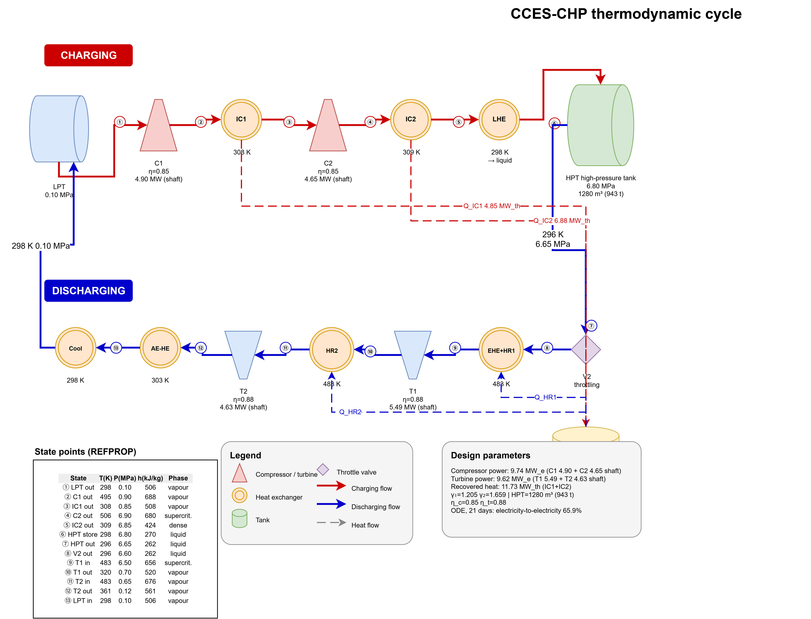

**图 1. CCES-CHP 系统流程图。** 充电与放电共用 LPT/HPT 与 HTV 储热；IC1/IC2 回收的压缩热供给 HR1/HR2 的回热需求与外部热负荷，EHE 则从环境/低品位热源取热。LPT、HPT 分别为低压、高压 CO₂ 储罐，HTV 为高温储热罐；图中编号对应图内的状态点表。

### 2.2 热力学建模

模型基于质量守恒与能量守恒建立，采用如下假设 [25–27]：

1. 单个调度周期内，充/放电功率与供热功率恒定；
2. CO₂ 储罐与环境无热交换；
3. 忽略换热器、管路与连接件的热损失与压力损失；
4. 忽略工质循环泵功耗；
5. 每个完整循环储存的压缩热，在满足膨胀过程需求后可全部用于供热。

两级压缩机与两级透平按多变机械建模（等熵效率 0.85 与 0.88），中间冷却器、回热器与蒸发器按稳态换热器建模。
轴功、电功率与换热负荷的表达式见补充材料式 (S1)–(S6)；按表 1 的设计点计算，得到 9.74 MW 压缩功率、
9.62 MW 透平输出与 11.73 MW_th 回收压缩热。

循环在温–熵平面上的形态见图 2。

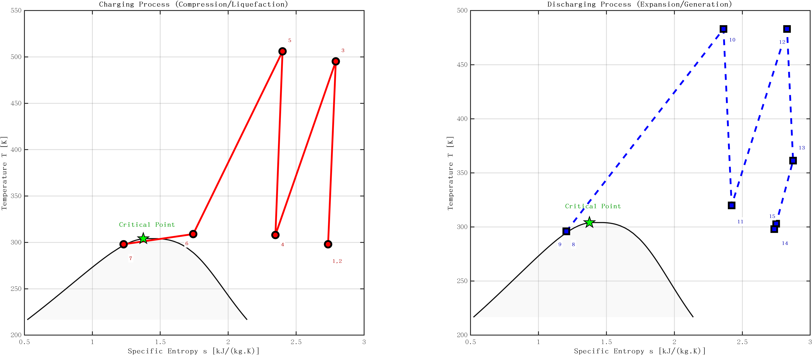

**图 2. CCES-CHP 循环的温–熵图（含 CO₂ 饱和穹顶）。** 状态点 1–7 为充电过程（压缩、中间冷却、液化），8–15 为放电过程（节流、汽化、回热、膨胀）；循环始终位于穹顶的汽相一侧。

### 2.3 系统设计参数

结果汇总于表 1。

**表 1. CCES-CHP 系统初始设计参数。**

| 参数 | 数值 | 单位 |
|-----------|-------|------|
| 环境温度 | 298 | K |
| 环境压力 | 0.101 | MPa |
| 设计充/放电功率 | 10 | MW |
| 充电时间 | 7.5 | h |
| 放电时间 | 5.0 | h |
| LPT 压力 | 0.102 | MPa |
| HPT 压力 | 6.80 | MPa |
| 压缩机入口温度（各级） | 308 | K |
| 透平入口温度（基准） | 483 | K |
| HTV 温度 | 495 | K |
| ATV 温度 | 298 | K |
| 换热器最小温差 | 5 | K |
| 压缩机等熵效率 | 0.85 | — |
| 透平等熵效率 | 0.88 | — |
| 电机机械效率 | 0.98 | — |
| 发电机机械效率 | 0.95 | — |
| HTV 储热容量 | 150 | MWh_th |
| HPT 容积 | 1280 | m³ |
| HPT 可用液量（10–90 %） | 943 | t |
| 充电质量流量 | 26.9 | kg/s |
| 放电质量流量 | 40.3 | kg/s |

*上述流量为参考设计值。按当前物性数据计算，对应压缩功率 9.74 MW、透平输出 9.62 MW，这也是第 3.1 节比例参数的来源。*

### 2.4 性能评价

$$ \eta_{electricity} = \frac{\int_{t_{discharge}} W_{T,E}(t) dt}{\int_{t_{charge}} W_{C,E}(t) dt} $$

$$ \eta_{heating,total} = \frac{\int Q_{HG-HE}(t) dt + \int Q_{LG-HE}(t) dt + \int Q_{AE-HE}(t) dt}{\int W_{C,E}(t) dt} $$

基准设计工况下，蒸发换热器单独核算：它以环境/低品位热（6.23 MW）把节流后的液体汽化，再由储存的压缩热只承担过热与再热负荷（9.65 MW 与 6.31 MW）。若把 HTV 的热量全部用于透平回热（X = 9.3 %、Y = 90.7 %），模型给出 η_electricity = 65.8 %、η_heating,total = 25.4 %（低温供热 11.3 %、膨胀后余热 14.2 %），综合能效 91.3 %。与参考设计（66.7 %、21.4 %）的残差来自状态点细节与蒸发器单独核算。

## 3 运行可行域的构造

### 3.1 无量纲耦合参数

为刻画压缩功率、压缩热、透平发电与质量流量之间的转换关系，定义四个无量纲参数：

$$ \gamma_1 = \frac{Q_{IC}(t)}{W_{C,E}(t)}, \qquad \gamma_2 = \frac{Q_{HR}(t)}{W_{T,E}(t)} $$

$$ \alpha_1 = \frac{m_C(t)}{W_{C,E}(t)}, \qquad \alpha_2 = \frac{m_T(t)}{W_{T,E}(t)} $$

γ₁ 表征单位充电功率产生的压缩热，γ₂ 表征单位放电功率所需的回热，α₁、α₂ 分别表征单位功率的充、放质量流量。

基准设计工况（T_turb = 483 K）下：γ₁ = 1.205、γ₂ = 1.659、α₁ = 2.762 kg/(s·MW)、α₂ = 4.191 kg/(s·MW)。需注意 γ₂ 是在**扣除 EHE 汽化负荷**后计算的：该负荷由环境热提供，不由 HTV 承担；若把它算进去，γ₂ 会被抬高到 2.31，从而得出一份并不存在的"热量赤字"。

### 3.2 双荷电状态（SOC）模型

CCES-CHP 的充放电同时涉及热转换与质量储存，因此建立基于 HTV 储热与 HPT 液体存量的双 SOC 模型。

热侧 SOC 用 HTV 储热量描述：

$$Q_{HTV}(t) = \begin{cases}
Q_{HTV}(t-1) + [\gamma_1 W_{C,E}(t) - Q_{heat}(t)] \Delta t & \text{充电–供热} \\
Q_{HTV}(t-1) - [\gamma_2 W_{T,E}(t) + Q_{heat}(t)] \Delta t & \text{放电–供热}
\end{cases}$$

气侧 SOC 用 HPT 中的 CO₂ 存量描述。工质经 LHE 液化后以常温液体储存，罐压（6.80 MPa）由充装泵维持而非相平衡，因此罐压基本恒定、不是状态变量；真正约束运行的是**液体存量**：

$$m_{HPT}(t) = \begin{cases}
m_{HPT}(t-1) + \alpha_1 W_{C,E}(t) \Delta t & \text{充电–供热} \\
m_{HPT}(t-1) - \alpha_2 W_{T,E}(t) \Delta t & \text{放电–供热}
\end{cases}$$

$$SOC_{gas}(t) = \frac{m_{HPT}(t)}{m_{HPT}^{full}}, \qquad m_{HPT}^{lower} \le m_{HPT}(t) \le m_{HPT}^{upper}$$

其中 m_full = 943 t（1280 m³ 液态 CO₂，298 K、6.80 MPa），运行窗口为满液量的 10–90 %。与 [20] 对 HPT 采用理想气体关系 p = mR_gT/V 不同，这里的存量表述与液体储存一致：754 t 的 CO₂ 以液体计约占 1057 m³，而同样质量以 6.8 MPa 气体计需要约 6000 m³。

两个 SOC 的实测联动见图 3。

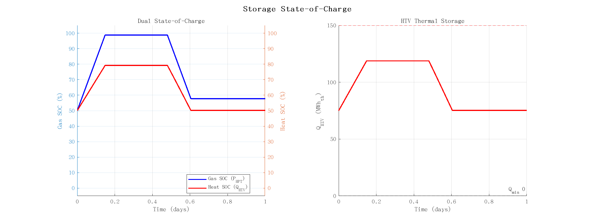

**图 3. 双 SOC 演化与 HTV 储热。** 左：气侧 SOC（液位，10–90 %）与热侧 SOC 同升同降。右：HTV 储热以 12.05 MW 充 7.59 h、以 18.28 MW 放 5 h，每周期精确回到 45 MWh；150 MWh 容量从未触及。

### 3.3 充电–供热可行域

充电时，压缩机消耗的电能转化为储热介质的热能与 CO₂ 的压力能，HTV 储热需满足：

$$Q_{HTV}^{lower} \leq Q_{HTV}(t) \leq Q_{HTV}^{upper}, \qquad 0 \leq Q_{heat}(t) \leq Q_{heat}^{max}$$

可行域边界由以下约束线围成：

$$Q_{heat}(t) = \frac{Q_{HTV}(t-1) - Q_{HTV}^{lower}}{\Delta t} + \gamma_1 W_{C,E}(t) \quad \text{(下限)}$$

$$Q_{heat}(t) = \frac{Q_{HTV}(t-1) - Q_{HTV}^{upper}}{\Delta t} + \gamma_1 W_{C,E}(t) \quad \text{(上限)}$$

$$Q_{heat}(t) = Q_{heat}^{max}, \qquad W_{C,E}(t) = W_{C,E}^{upper}$$

$$W_{C,E}(t) \le \frac{m_{HPT}^{upper} - m_{HPT}(t-1)}{\alpha_1 \Delta t} \quad \text{(存量约束)}$$

**核心特征**：正斜率 +γ₁ 表明充电时电与热是**互补**的——充电功率越大，产生的压缩热越多，可供的热也越多。存量约束只有在储罐接近上限（约 89 % SOC 以上）时才起作用。

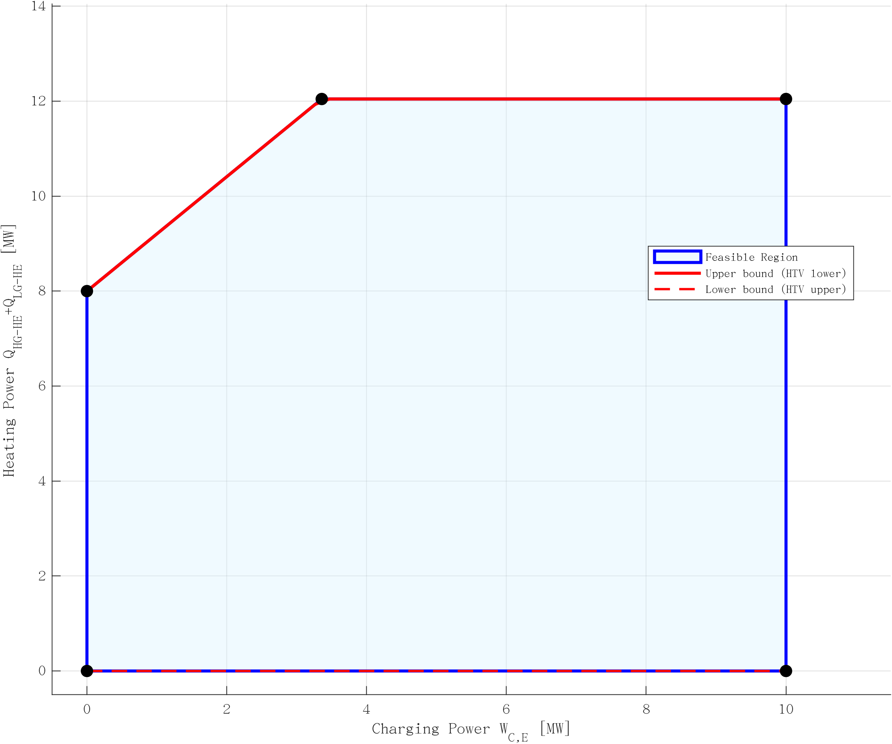

**图 4. 充电–供热可行域。** 正斜率 +γ₁ 体现电热互补：充电功率越大，供热上限越高。为让斜约束线落入绘图范围，图中采用了一个示意性的可用热量水平；SOC 较高时可行域退化为设备矩形。

### 3.4 放电–供热可行域

放电时，储热介质的热能与 CO₂ 的压力能转化为电能与直接供热，边界由下式确定：

$$Q_{heat}(t) = \frac{Q_{HTV}(t-1) - Q_{HTV}^{lower}}{\Delta t} - \gamma_2 W_{T,E}(t) \quad \text{(上限)}$$

$$Q_{heat}(t) = \frac{Q_{HTV}(t-1) - Q_{HTV}^{upper}}{\Delta t} - \gamma_2 W_{T,E}(t) \quad \text{(下限)}$$

$$Q_{heat}(t) = Q_{heat}^{max}, \qquad W_{T,E}(t) = W_{T,E}^{upper}$$

$$W_{T,E}(t) \le \frac{m_{HPT}(t-1) - m_{HPT}^{lower}}{\alpha_2 \Delta t} \quad \text{(存量约束)}$$

**核心特征**：负斜率 −γ₂ 表明放电时电与热是**竞争**的——发电与供热争夺同一份 HTV 储热，右上角（同时最大功率与最大供热）不可行。

零供热时的最大功率、零功率时的最大供热分别为：

$$W_{max} = \min\left[\frac{Q_{HTV}(t-1) - Q_{HTV}^{lower}}{\gamma_2 \Delta t},\ \frac{m_{HPT}(t-1) - m_{HPT}^{lower}}{\alpha_2 \Delta t},\ W_{T,E}^{upper}\right], \quad Q_{max} = \frac{Q_{HTV}(t-1) - Q_{HTV}^{lower}}{\Delta t}$$

存量约束只在约 16 % SOC 以下起作用：943 t 的罐在 10 MW 下 1 h 放出 151 t，因此深度放电的最后一段会转为存量受限，其余时段仍受热或设备约束。

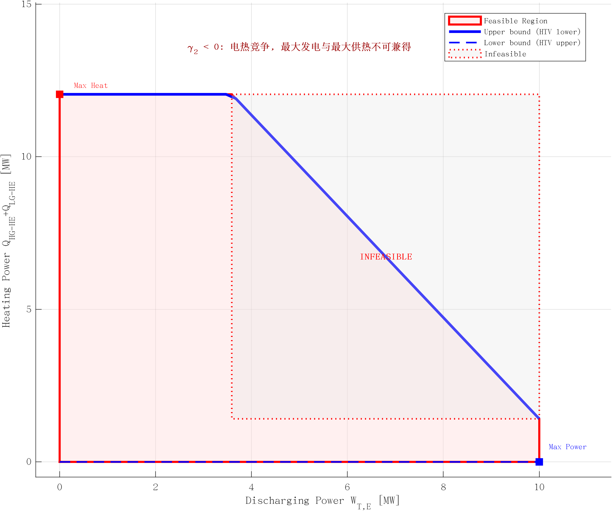

**图 5. 放电–供热可行域。** 负斜率 −γ₂ 体现电热竞争：发电与供热共享同一份热预算，右上角（两者同时最大）不可行。图中同样采用示意性的可用热量水平。

### 3.5 运行参数对可行域的影响

供热率 X（高温与低温供热之和占储热总量的比例）与 γ₁、γ₂、α₁、α₂ 的关系为

$$X = 1 - \frac{\gamma_2 \alpha_1}{\gamma_1 \alpha_2}$$

该式由循环能量平衡 Q_IC·t_c = Q_HR·t_d + Q_LG·t_d 与质量平衡 α₁W_{C,E}t_c = α₂W_{T,E}t_d 联立得到。设计点处 X = 9.3 %，与 2.4 节的热力学核算一致。由于这些无量纲量本身已定义在电功率上，电机与发电机效率不能在此式中二次引入。

透平入口温度对两个耦合系数的影响方向不同：按 REFPROP 直接计算，γ₂ 只从 483 K 的 1.659 变到 503 K 的 1.691（+1.9 %），因为回热负荷与透平功同步缩放；而 α₂ 从 4.191 降到 3.993 kg/(s·MW)（−4.7 %），单位质量做功增加。[20] 提出的近似修正因子意味着 γ₂ 下降约 23 %，这一估计未被采用——按物性直接计算，回热系数几乎不随温度变化。其后果在 6.4 节定量给出：提高 T_turb 几乎不改变可行域形状，但会降低单位功率的取液量并提高电效率。

---

## 4 机器学习方法

### 4.1 训练数据生成

数据生成流程用 MATLAB 实现，调用 REFPROP v10.0 在 15 个热力学状态点上计算 CO₂ 物性。试验设计系统采样参数空间：

结果汇总于表 2。

**表 2. 训练数据参数采样方案。**

| 参数 | 范围 | 步数 | 说明 |
|-----------|-------|-------|-------------|
| SOC_heat | 0–100 % | 16 | HTV 储热状态 |
| SOC_gas | 0–100 % | 11 | HPT 液体存量（10–90 % 可用） |
| W | 0–10 MW | 11 | 功率设定值 |
| Q | 0–12.05 MW | 10 | 供热设定值（设备上限 = γ₁·W_design） |
| Mode | 0, 1 | 2 | 0 = 充电，1 = 放电 |

样本总数：16 × 11 × 11 × 10 × 2 = **38,720**。

每个参数组合的可行性标签与两个边界值由约束方程解析给出：当点落在 3.3–3.4 节的上下边界线之间、
位于设备矩形内且满足存量约束时判为可行。完整判据与特征、标签定义见补充材料说明 S8；
九个输入为两个 SOC、W、Q、模式与四个系数。

正是存量项让气侧状态携带信息：若没有它，可行性标签对 SOC_gas 完全不敏感，其重要性会塌缩到 0.0015——这正是纯热约束集的产物；加入后，3,520 个采样组合中有 2,896 个的可行性标签会随气侧轴变化。

**每个样本的特征**：SOC_heat_pct、SOC_gas_pct、W_MW、Q_MW、mode、γ₁、γ₂、α₁、α₂
### 4.2 可行性预测的 XGBoost 分类器

XGBoost 作为主分类器，超参数为 n_estimators = 200、max_depth = 6、learning_rate = 0.1、subsample = 0.8、colsample_bytree = 0.8。数据集按 8:2 划分（30,976 训练 / 7,744 测试），并按可行性标签分层。

用 TreeSHAP 做归因，结果见表 3。

**表 3. XGBoost 分类器的 TreeSHAP 归因。**

| 特征 | 平均 SHAP 值 | 占比（%） | 物理解释 |
|---------|-------------|-----------|------------------------|
| SOC_heat_pct | 4.37 | 41.5 | HTV 热状态——决定约束截距 |
| SOC_gas_pct | 2.64 | 25.1 | HPT 液体存量——在窗口两端约束功率 |
| W_MW | 1.55 | 14.7 | 功率设定值——约束线上的位置 |
| mode | 1.37 | 13.0 | 充电/放电——决定约束方向 |
| Q_MW | 0.61 | 5.8 | 供热设定值——可行域内的竖直位置 |
| γ₁、γ₂、α₁、α₂ | 0.00 | 0.0 | 训练集中为常数（固定 T_turb） |

基于 gain 的重要性会把运行模式排在首位（早期评估中为 45.5 %），但 gain 奖励的是"被频繁切分"的特征，而二元分裂的代价很低。TreeSHAP 度量的是对预测的边际贡献，因此把两个储能状态排在前面（41.5 % 与 25.1 %），这与第 3 节的解析结构一致：热侧状态定截距、气侧状态定功率上限。气侧特征也是"约束集承载了多少物理"的判据：把它从特征向量中移除，交叉验证准确率从 100.00 % 降到 90.68 %（下降 9.3 个百分点）；而在修正前的约束集下，它的 gain 重要性只有 0.0015，且不改变任何标签。

### 4.3 边界预测的 XGBoost 回归器

另训练两个回归器预测可行域边界：W_max_feasible（给定 SOC 下的最大可行功率）与 Q_max_feasible（给定 SOC 下的最大可行供热）。训练集为可行子集（31,549 个样本），超参数 n_estimators = 150、max_depth = 5、learning_rate = 0.1。

### 4.4 作为基准对比的 MLP

多层感知机作为基准模型：3 个隐层（128×64×32），ReLU 激活，Adam 优化器与自适应学习率，批大小 256，最多 300 轮；输入用 StandardScaler 标准化。两个模型的超参数与算力开销见补充材料表 S3–S5。

### 4.5 模型性能

结果汇总于表 4。

**表 4. 五折分层交叉验证下的模型性能。**

| 模型 | 任务 | 指标 | 数值 |
|-------|------|--------|-------|
| XGBoost | 可行性分类 | CV 准确率 | **100.00 ± 0.01 %** |
| 随机森林（300） | 可行性分类 | CV 准确率 | 99.96 ± 0.02 % |
| 直方图梯度提升 | 可行性分类 | CV 准确率 | 99.96 ± 0.04 % |
| MLP（128×64×32） | 可行性分类 | CV 准确率 | 99.74 ± 0.11 % |
| 极端随机树（300） | 可行性分类 | CV 准确率 | 99.90 ± 0.04 % |
| 决策树（深度 6） | 可行性分类 | CV 准确率 | 96.22 ± 0.16 % |
| 逻辑回归 | 可行性分类 | CV 准确率 | 82.01 ± 0.04 % |
| XGBoost | W_max 回归 | R² / RMSE | **1.0000** / 1e-4 MW |
| XGBoost | Q_max 回归 | R² / RMSE | **1.0000** / < 1e-4 MW |

由此可得三点。第一，线性分类器只有 82.01 %，这是"可行集是多边形而非半空间"的定量表述——没有任何单一超平面能把可行与不可行分开。第二，两个边界回归是**精确**复现而非近似：W_max 与 Q_max 都是状态的分段线性确定性函数（3.3–3.4 节），树集成能解析到标签精度；早先的 R² = 0.9964 来自单次划分与较浅的集成。第三，MLP 比 XGBoost 低 0.26 个百分点：其平滑激活把热、存量与设备三个约束相交处的棱角磨圆了。

### 4.6 为什么用机器学习

尽管可行性约束是解析线性的，机器学习的价值仍体现在三方面：

1. **推理速度**：单次 XGBoost 预测遍历约 200 棵树，耗时微秒级；而一次完整的 REFPROP 热力学仿真需要多次物性调用与迭代收敛；在国家尺度的能源系统优化中，替代模型承担的就是同样的角色 [35]。
2. **参数空间泛化**：由于 γ₁、γ₂、α₁、α₂ 作为输入特征，同一套模型结构可以在 T_turb 扫描数据上重训，并在连续参数变化间插值，无需重跑物性仿真。本文只用了单一设计点，温度扫描在 6.4 节单列；多温度联合训练留待后续。
3. **与优化无缝衔接**：训练好的模型可作为快速替代约束，在调度循环内被查询上千次，从而支撑实时决策。

## 5 调度优化框架

### 5.1 问题表述

给定逐时的电负荷、热负荷与风电出力，C-CHP 机组按"以热定电"运行，CCES-CHP 作为补充源跟踪剩余调度指令：

$$Elec\_Dispatch(t) = Elec\_Load(t) - CCHP\_elec(t) - Wind\_Power(t)$$

$$Heat\_Dispatch(t) = Heat\_Load(t) - CCHP\_heat(t)$$

其中 Elec_Dispatch 为正表示需要充电（储能），为负表示需要放电（释能）。C-CHP 容量 30 MW、热电比 1.2，故 CCHP_heat = min(Heat_Load, 36 MW)、CCHP_elec = CCHP_heat / 1.2。

每个时刻的优化目标是在满足可行性约束的前提下，找到使加权跟踪偏差最小的 (W, Q)：

$$\min_{W,Q} \quad |W - W_{target}| + \lambda \cdot |Q - Q_{target}|$$

$$\text{s.t.} \quad f_{ML}(SOC_{heat}, SOC_{gas}, W, Q, mode) = 1 \quad \text{(可行)}$$

$$0 \leq W \leq W_{max}, \quad 0 \leq Q \leq Q_{max}$$

其中 λ = 0.5 反映电、热跟踪之间的权重，f_ML 为 XGBoost 可行性分类器。

### 5.2 基于机器学习的网格搜索

每小时内先按调度指令的符号确定模式，再在零到截断目标之间构造 20 × 15 的 (W, Q) 网格，逐个用分类器打分并取最优点，
最后按 3.2 节的热平衡推进 SOC。完整流程见补充材料算法 S1。该网格在 W 与 Q 两个方向的分辨率约为 0.5 MW，
每小时 300 次、全天 7,200 次预测在毫秒级完成。

### 5.3 规则调度基准

规则调度作为对照：
- 始终尽量完整跟踪调度指令；
- 在设备上限处截断（W ≤ 10 MW，Q ≤ 12.05 MW）；
- 用解析式检查 HTV 的 SOC 约束，不做优化；
- 把 W 与 Q 当作独立目标，不考虑两者对同一份热预算的耦合消耗。

### 5.4 网格搜索的最优性

逐时策略是贪心的：它只最大化瞬时得分，不关心当前决策如何改变后续时段可用的状态。由于模式一旦由调度指令的符号确定，所有约束与目标对 (W, Q) 都是线性的，同一个 24 h 问题可以写成线性规划精确求解。我们用 SciPy 调用 HiGHS，采用与启发式完全相同的边界、储热递推与目标函数，因此该 LP 值是可达跟踪误差的严格下界。

结果汇总于表 5。

**表 5. 各调度策略的最优性差距（λ = 0.5）。**

| 策略 | 目标值 | 距 LP | 供热（MWh） | 放电（MWh） | 电跟踪率（%） |
|--------|-----------|-----------|-----------|-----------------|------------------------|
| 规则调度 | 85.876 | +3.63 % | 44.00 | 66.6 | 62.8 |
| ML 网格（20×15） | 86.041 | +3.83 % | 46.29 | 66.3 | 62.7 |
| LP 最优 | **82.868** | — | 14.74 | 84.3 | 71.0 |

有两点值得强调。其一，网格搜索距其自身目标的最优解还有 3.8 %，且在 λ = 0.5 下并不比规则调度更好。其二，原因在最优解中一目了然：由于电权重大于热权重，LP 放电 84.3 MWh 却只供 14.7 MWh 热——目标函数根本没有要求供热。因此，启发式那 5.2 % 的供热增益不是优化结果，而是替代模型在边界附近偏保守（把可行点判为不可行）的副作用：它把储热留给了后面时段。6.5 节把这一点做成对 λ 的敏感性分析。

---

## 6 结果与讨论

### 6.1 算例设置

算例系统由 20 MW 风电、30 MW 常规 CHP（热电比 1.2）与 10 MW/50 MWh 的 CCES-CHP 组成，选取供暖季的一个典型日，其 24 h 电负荷、热负荷与风电出力见图 6，逐时数据见补充材料表 S1。

关键特征：夜间（1–7 时）风电充裕，中午风电很低；电负荷在正午（12–15 时）与傍晚（19–23 时）双峰；热负荷早晚高，是典型的冬季采暖曲线。可用的充电窗口包括夜间弃风与中午的负荷低谷。

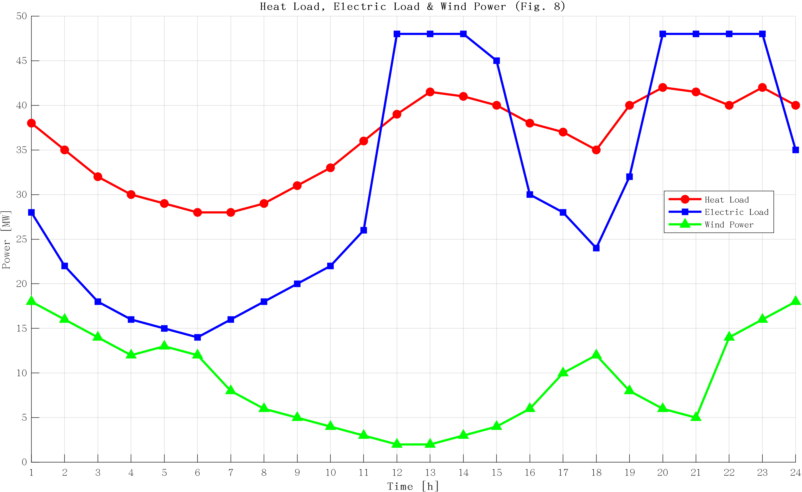

**图 6. 24 h 电负荷、热负荷与风电出力曲线。** 风电夜间高、电负荷正午与傍晚双峰、热负荷早晚双峰，因而夜间与中午低谷构成充电窗口。

### 6.2 调度优化结果

规则调度与 ML 引导调度的 24 h 对比如图 7 与表 6 所示。

**表 6. 24 h 调度性能对比。**

| 指标 | 规则调度 | ML 引导 | 变化 |
|--------|-----------|-----------|--------|
| 总充电量（MWh） | 66.0 | 66.0 | — |
| 总放电量（MWh） | 66.6 | 65.0 | −2.4 % |
| 总供热量（MWh） | 44.0 | **46.3** | **+5.2 %** |
| 有效放电小时数（h） | 9 | **16** | **+78 %** |
| 任意非零功率小时数（h） | 17 | 24 | +41 % |
| 末态 SOC_heat（%） | 0.2 | 0.2 | — |
| 电调度跟踪率（%） | 44.9 | 45.4 | +0.5 pp |

之所以同时报两个口径，是因为早期版本把二者混为一谈："有效放电小时数"只统计调度指令为放电且机组输出正功率的小时（9 → 16），而"任意非零功率小时数"还把充电小时算进来（17 → 24）。会议版所称的 17 → 24 指的是后者。

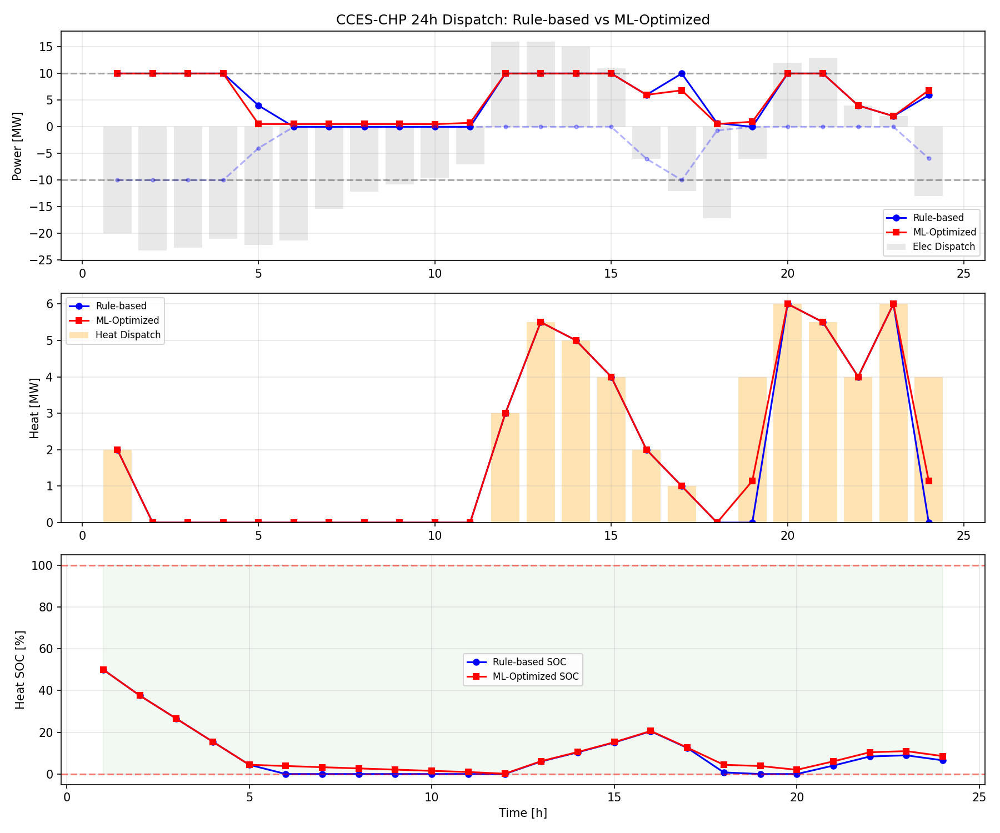

**图 7. 规则调度与 ML 引导调度的对比。** 上：电调度指令与实际充/放电功率；中：热调度指令与实际供热；下：HTV 热 SOC。ML 引导策略在 18–24 时仍维持小功率放电，而不是在第 17 小时后归零。

三点观察：

**观察 1——有效放电时段更长。** 规则调度在第 10 小时前后就把 HTV 放空，此后只能跟踪剩余热负荷；ML 引导策略在 16 个需要放电的小时里都保持了正出力。两者都把储热用尽（末态 0.2 %），差别在时序而非预留裕量。

**观察 2——以放电量换供热量。** 供热从 44.0 升到 46.3 MWh，总放电量却下降 2.4 %。机制不是最优分配：替代模型在边界附近把一些可行点判为不可行，于是网格搜索选到比解析可行域允许值更低的功率（例如第 5 小时取 0.53 MW 而非 3.68 MW），把热量留给了后续时段。显式给供热加权会得到什么结果，见 6.5 节。

**观察 3——启发式并非最优。** 在同一目标下，5.4 节的 LP 达到 82.868，而网格搜索为 86.041，甚至规则调度都更接近最优。因此替代模型的价值在推理速度与参数泛化，而不在搜索本身。

### 6.3 调度收益来自哪里

逐时决策暴露出三条机制，其中只有一条是真正的优化效应。

**机制 1：边界估计偏保守。** 在边界附近，模型把解析可行域允许的点判为不可行：第 5–9 小时取 0.53 MW（允许 3.7 MW），第 17 小时取 6.8 MW（允许 10 MW）。24 个所选点全部物理可行，因此这种保守性相当于隐性储热裕量，也是 5.2 % 供热增益的真正来源。对解析约束加一个显式裕量可得同样效果且不增加建模成本——因此撤回"电热动态最优分配"的归因。

**机制 2：降功率。** 固定存量以 γ₂W + Q 的速率消耗，功率减半大致使时长翻倍。两种策略都降功率，但规则调度是放空后才降，替代模型提前降。

**机制 3：按下一段需求充电。** ML 策略在第 12–15 与 20–23 时充电，紧邻晚高峰，末态 SOC 0.2 %；不过充由 SOC 上限保证，不是优化器的功劳。

这些都不突破能量上限。满功率、满供热放电只能维持

$$t_{max} = \frac{Q_{HTV}^{upper}}{\gamma_2 W_{max} + Q_{max}} = \frac{150}{1.659 \times 10 + 12.05} \approx 5.2\ \text{h}$$

24 h 覆盖靠降功率与再充电，而不是额外容量。

### 6.4 透平入口温度的影响：效率而非扩域

两个耦合系数随 T_turb 反向变化：温度升高使单位质量比功增大，α₂ 下降 4.7 %；而回热负荷与透平功同步缩放，γ₂ 几乎不变（+1.9 %，仍在 1.66 附近）。由于放电斜率是 −γ₂，γ₂ 不变意味着 (W, Q) 域几乎不变；改变的是给定液量能撑多久，它按 1/α₂ 缩放。

**表 7. 透平入口温度的影响（REFPROP 计算）。**

| 项目 | 483 K（基准） | 503 K | 变化 |
|----------|-----------------|-------|--------|
| γ₂（回热系数） | 1.659 | 1.691 | **+1.9 %** |
| α₂（kg/(s·MW)） | 4.191 | 3.993 | **−4.7 %** |
| SOC_heat = 10 % 时的最大功率（MW） | 9.04 | 8.87 | −1.9 % |
| SOC_heat = 10 % 时的可行域积分面积（MW²） | 65.2 | 64.0 | **−1.9 %** |
| 固定液量下的满功率放电时长（h） | 5.00 | 5.25 | **+5.0 %** |
| 电–电效率（%） | 65.9 | 69.2 | +3.3 pp |

SOC ≥ 20 % 时可行域是完整矩形——即使 10 MW，16.6 MW 热抽取加 12.05 MW 供热仍低于一小时可用的 30 MW——温度在那里不起作用。热约束在约 19 % SOC 以下切域、功率上限在约 11 % 以下起作用；10 % SOC 处 γ₂ 略增使面积缩小 1.9 %（各 SOC 的面积见补充材料表 S2）。

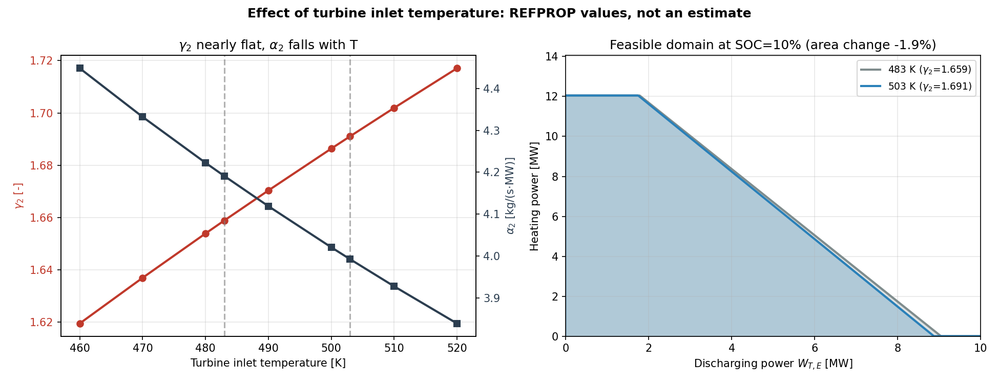

**图 8. 透平入口温度对可行域的影响。** 左：460–520 K 区间内 REFPROP 计算的 γ₂ 与 α₂。右：SOC_heat = 10 % 时 483 K（灰）与 503 K（蓝）的放电可行域，两条边界几乎重合；温度主要改变时长与效率，而非域的形状。

175 点扫描（Th 460–520 K、η_t 0.84–0.92、P_HPT 6.0–7.6 MPa）显示三个旋钮中谁真正在动耦合系数。温度与压力固定时，η_t 由 0.84 升到 0.92 使 γ₂ 降 5.7 %（460 K、6.8 MPa 下 1.670→1.574）；温度与效率固定时，P_HPT 由 6.0 升到 7.6 MPa 使 γ₂ 升 3.2 %（1.597→1.649）。温度最弱，仅 0.09–0.11 %/K，即 60 K 内 +5–6 %——这正是上述"近似不变"的定量形式。可行域因此只移动约 ±7 %：10 % SOC 处面积 60.3–69.7 MW²（基准 65.2），α₂ 覆盖 3.606–4.752 kg/(s·MW)，对应固定液量下 4.41–5.81 h 满功率放电；电效率 58.3–74.2 %。

扫描还暴露了单温度研究看不到的边界：175 点中 32 点的热闭合解为负（X < 0），即仅回热需求已超过压缩热，机组能发电而不能供热。这些点只出现在 500 K 以上，且集中在低压：6.0 MPa 的 35 点中 13 个、6.4 MPa 10 个、6.8 MPa 7 个、7.2 MPa 2 个、7.6 MPa 为 0；基准（η_t = 0.88、6.8 MPa）下盈余在约 517 K 归零。因此把 Th 从 460 K 提到 520 K，会把 16.5 % 的热盈余变成 2.5 % 的赤字：运行包络存在由热平衡而非透平决定的上限，提高储存压力可放宽它。

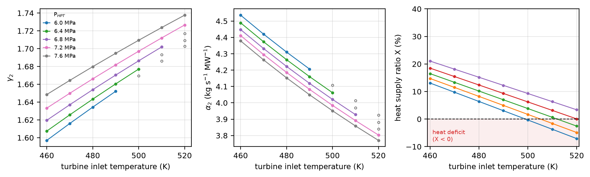

**图 9. 多参数设计扫描。** （a）η_t = 0.88 时五个储存压力下的 γ₂ 与（b）α₂ 随透平入口温度的变化；（c）同一剖面下的供热率 X。实心标记与实线为可行工况；空心标记为供热赤字点（X < 0），已从拟合统计中剔除。

放电时 Q = −γ₂W + (Q_HTV − Q_lower)/Δt，故 Q_max 与 γ₂ 无关、W_max 与 γ₂ 成反比；γ₂ 略升只会使域略缩而非扩张。收益在效率（65.9→69.2 %）与时长（5.00→5.25 h）。透平入口温度是效率杠杆而非扩域杠杆，这也纠正了 [20] 近似因子给出的 γ₂ 降 23 %：按 REFPROP，γ₂ 在 460–520 K 内只在 1.620–1.717 之间变。

### 6.5 对电–热权重的敏感性

5.1 节的目标函数用 λ = 0.5 加权电、热偏差，却没有给出依据。扫描 λ 可以区分"哪些行为属于系统、哪些属于权重"。

结果汇总于表 8。

**表 8. 供热量（MWh）随热权重 λ 的变化。**

| λ | 规则调度 | ML 网格 | LP 最优 |
|---|-----------|----------------|-----------|
| 0 | 44.00 | 0.00 | 14.74 |
| 0.25 | 44.00 | 44.29 | 14.74 |
| 0.50 | 44.00 | 46.29 | 14.74 |
| 1.0 | 44.00 | 48.00 | 52.00 |
| 2.0 | 44.00 | 48.57 | 52.00 |
| 5.0 | 44.00 | 48.57 | 52.00 |

由此可得三点。规则调度对 λ 不敏感，因为它从不拿功率换热；ML 引导策略在 λ ≤ 2 时单调改善并饱和于 48.6 MWh；LP 最优饱和于 52.0 MWh，比规则调度高 18 %，这才是"供热感知"目标真正能争取到的空间。由于最优解在 λ ≥ 1 时已饱和，想让供热最大化的规划者应至少把热权重的量级取到与电相当；而在 λ = 0.5 下，同一个最优解只供 14.7 MWh——决定结果的是权重而不是物理。因此供热量应以 λ 的函数形式报告，而不是给单一数字。三条曲线见图 10。

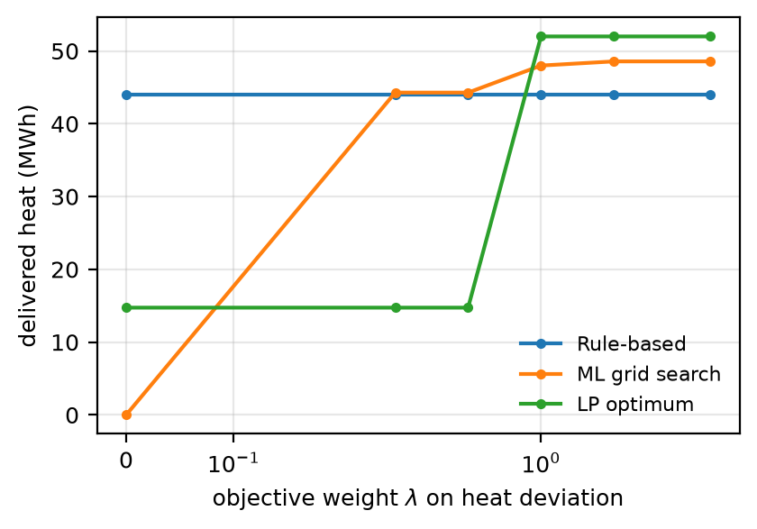

**图 10. 供热量随热权重 λ 的变化。** 圆点为规则调度、方块为 ML 网格、三角为 LP 最优。规则调度与 λ 无关；启发式饱和于 48.6 MWh，精确最优饱和于 52.0 MWh。

### 6.6 讨论

#### 6.6.1 准确率及其物理基础

100 % 是预期结果：标签来自约束集本身，任务是复现已知的分段线性边界，而不是发现边界。它证明的是替代模型能精确复现该边界、从而在推理阶段替代物性计算。MLP 的 99.74 ± 0.11 % 误差集中在热、存量与设备三个约束相交的棱角处——平滑激活把那里磨圆了，XGBoost 的轴对齐分裂则保留棱角。线性基线 82.01 % 说明可行集是多个半空间的交。

#### 6.6.2 从静态约束到可控变量

调度通常把可行域当作固定约束，这里它成为变量：外层对 T_turb 寻优以改变 α₂（进而改变时长与效率），内层在域内优化 (W, Q)。替代模型让这种双层搜索在计算上可行。

#### 6.6.3 含义与局限

有效放电更长（9→16 h）、供热更多（44.0→46.3 MWh）确实影响运行，但有三个限定：这是把同一份热量摊到更多小时而非新增（放电量降 2.4 %）；它取决于权重 λ，价格驱动的目标应把 λ 取为热价与电价之比；在 λ ≈ 0.43 时其经济价值很小（见 7.3 节）。

由此有四点局限。训练假定每次运行 γ₁、γ₂ 固定，故 α₂ 尚不能在循环内优化，6.4 节的多参数扫描是第一步。网格搜索距 LP 最优 3.8 %，这是建模选择而非算力障碍。价格只通过 λ 进入，未进入目标函数。前瞻只有一小时，动态规划或 MPC 可跨时段协调。最后，存量约束只在窗口两端起作用（放电低于 16 % SOC、充电高于 89 % SOC），因为储罐按五小时设计；罐更小的系统会把双 SOC 耦合摊到全域。

---

## 7 经济性评估

### 7.1 数据与假设

经济与调度解耦：把表 6 的逐日能量按公开价格计价，任何策略都可重新计价而无需重解优化。

收入按山东 2025 年 3 月工商业电价 [36]：峰段 1.0475 元/kWh、平段 0.6899、谷段 0.3324、深谷 0.2303，按 7.10 元/美元折为 147.5、97.2、46.8、32.4 美元/MWh。机制规定峰段上浮 70 %、谷段下浮 70 %、尖峰上浮 100 %、深谷下浮 90 % [36]，即约 101 美元/MWh 的峰谷价差。供热按燃气工业蒸汽 349 元/吨（济南，2023 年）计价 [37]，按 2.8 GJ/t 折约 63 美元/MWh_th。

投资取大型压缩空气与液态 CO₂ 储能文献的中位值 [28–32]：透平机械 900 美元/kW、地上 CO₂ 储罐 60 美元/kWh、储热 25 美元/kWh_th，本机组合计 15.75 百万美元；图 11 的 0.7–2.0 倍数覆盖报价可能落入的区间。运维 2.5 %/年、折现率 7 %、寿命 25 年 [28,30]；套利按 330 天、供热按采暖季 150 天计。项目报价属企业数据，不予披露。

LCOE 为年化投资加运维除以年放电量；LCOH 把同一成本除以电与热的总输出；NPV 按 7 % 折现 25 年。

### 7.2 结果

**表 9. 三种调度策略的经济性（山东电价，2025 年）。**

| 策略 | 年收入（百万美元） | LCOE（美元/MWh） | LCOH（美元/MWh） | 回收期（年） | NPV（百万美元） |
|--------|----------------------|----------------|----------------|--------------|------------|
| 规则调度 | 2.64 | 79.4 | 61.1 | 7.0 | **+10.41** |
| ML 引导 | 2.58 | 81.4 | 61.5 | 7.2 | +9.75 |
| LP 最优（λ = 1） | 2.48 | 85.6 | 61.9 | 7.6 | +8.56 |

三种策略均盈利：回收期 7–8 年，15.75 百万美元投资的净现值 8.6–10.4 百万美元。排序与热力排序相反——收入主体是放电量（套利 2.1–2.2 百万美元，供热仅 0.4），规则调度放电最多故收入最高，供热最多的策略反而最低。

假设集仍有空间：投资不变时净现值在 62 美元/MWh 的峰谷价差处归零（目录提供 101）；价差不变时投资可升到 23.4 百万美元（1.48 倍）才转负。

### 7.3 解释

这是对第 6 节的限定而非否定。电价隐含 λ ≈ 63/147.5 ≈ 0.43，接近全文采用的 0.5；在该权重下每天 2.3 MWh 的供热增量约值 0.03 百万美元/年，比套利收入低两个数量级。若供热按蒸汽价补偿，机组应以 λ ≈ 1 运行，此时 6.5 节给出 48.6 MWh（启发式）与 52.0 MWh（最优），经济上更优的策略也随之从规则调度转向供热感知调度。

边界是诚实的：可行域与调度为"跟踪"优化而非为"利润"优化，二者之间只有 λ 一条纽带。把电价内生化——在优化内部引入分时电价的利润目标——留待后续工作；本文给出的可行集与最优性基准正是这种表述所需的两块构件。

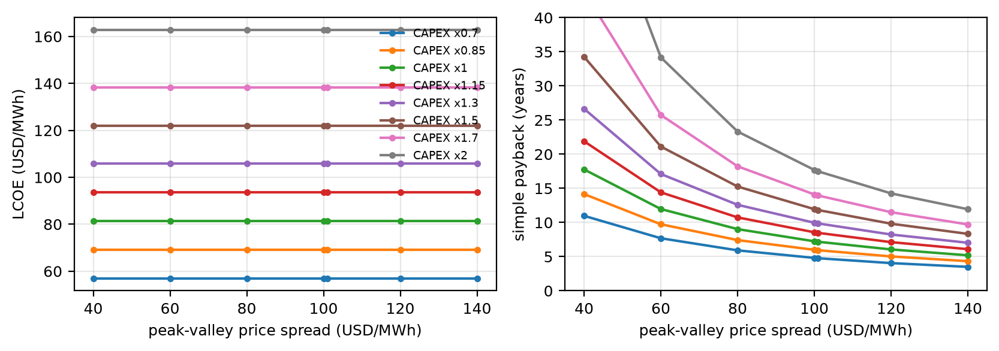

**图 11. 经济性对电价与投资的敏感性。** 左：平准化电成本；右：静态回收期。横轴为峰谷价差，曲线对应 0.7–2.0 倍投资（ML 引导调度）。

---

## 8 结论

本文用机器学习构造并优化 CCES-CHP 的运行可行域。

1. 无量纲系数 γ₁/γ₂ 与比例参数 α₁/α₂ 耦合电、热、质量三个流；双 SOC（储热 + CO₂ 液体存量）把可行域化为线性约束，存量项约束窗口两端的功率，使气侧状态具备物理意义。

2. 以 38,720 个 REFPROP 样本训练，XGBoost 与 MLP 在五折交叉验证下分别达 100.00 ± 0.01 % 与 99.74 ± 0.11 %（线性基线 82.01 %），并精确复现 W_max 与 Q_max（R² = 1.0000）。TreeSHAP 把 41.5 % 与 25.1 % 的贡献归于热侧与气侧，去掉气侧损失 9.3 个百分点。

3. ML 引导调度把供热从 44.0 提到 46.3 MWh（+5.2 %）、有效放电小时从 9 增到 16，代价是放电量降 2.4 %，末态 SOC 相同（0.2 %）。增益来自替代模型在边界附近的保守性，而非最优分配：同一目标下网格搜索比精确 LP 差 3.8 %，规则调度甚至略好。λ 扫描给出真实空间：启发式 48.6 MWh、最优 52.0 MWh。

4. 483–503 K 区间内 γ₂ 仅由 1.659 变到 1.691，低 SOC 处可行域面积只变 −1.9 %；升温的真实收益是单位功率取液量降 4.7 %、满功率放电延长 5.0 %（5.00→5.25 h）、电–电效率 65.9→69.2 %。参数应按效率与时长选择，而不是按扩域。

5. 7,200 次可行性查询在毫秒级完成，使实时调度成为可能，而完整热力学仿真做不到。

6. 在 2025 年 3 月山东电价下三种策略均在 7.0–7.6 年回收，15.75 百万美元投资的净现值为 8.6–10.4 百万美元；盈亏平衡为 62 美元/MWh 的峰谷价差（目录提供 101），或 48 % 的投资超支。由于收入主体是放电量，在电价隐含的 λ ≈ 0.43 下规则调度最优；只有 λ ≥ 1 时供热感知调度才更优。

该框架可支撑高比例可再生能源下 CCES-CHP 的实时调度、容量规划与运行优化。

---

## 致谢

本工作得到中国科学院理化技术研究所的支持。

---

## 作者贡献声明

**宋衍昌**：概念化、方法、软件、形式分析、初稿撰写。**张振涛**：监督、经费获取、审阅与修改。**杨俊玲**：验证、调查、审阅与修改。

## 利益冲突声明

作者声明不存在已知的可能影响本文工作的经济利益冲突。

## 数据可用性

MATLAB 与 Python 代码、38,720 条训练样本以及全部图件的源文件见 https://github.com/YanchangSongTipc/CO2_energy_storage 。项目报价属保密信息，未予复现；经济性评估所用区间见 7.1 节。

---

## 参考文献

参考文献与英文版完全一致（27 条，见 `paper_manuscript.md` 的 References 一节），此处不再重复列出，以免两处维护不同步。

---
